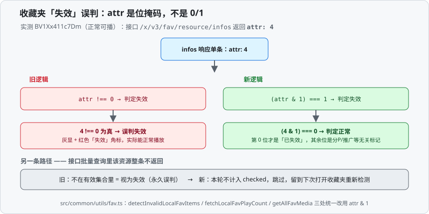

# 开发日志（DEVLOG）

> 这里是**入口和当月未归类记录**，不是全部历史。按专题或月份打开对应文件，避免每次任务都加载整部开发史。

## 写入规则

1. 每次提交前记一条：说明这个提交做了什么、效果是什么、关键数据流如何变化；不要复述 diff。
2. 可归入专题的记录写入 `docs/devlog/<年份>-<专题>.md`。同一专题同一年共用一个文件，记录用 `## 日期 type: 概述`，新的在上；跨年新建文件，不追加到旧年。
3. 纯文档、杂项等单次改动直接作为本文件的 `##` 记录。若后来形成明确专题，再把相关记录一起迁入专题文件。
4. 开始新月份时，将上个月留在本文件的单次记录移到 `docs/devlog/archive/YYYY-MM.md`；归档文件只追加、不回写。这样根文件最多保留一个月的单次记录。
5. 简单改动效果足以看懂，不必展开；复杂功能必须配图（数据流 / 架构），图片放 `docs/devlog-assets/` 并在对应专题或归档中引用。
6. 坑、失败尝试和反复权衡的设计决策不写开发日志，归入对应的 `docs/ideas/` 文件。

## 2026 专题日志

- [移动端](docs/devlog/2026-移动端.md)
- [Web 版](docs/devlog/2026-Web版.md)
- [播放时长与本地收藏](docs/devlog/2026-播放时长与本地收藏.md)
- [开发工具与性能](docs/devlog/2026-开发工具与性能.md)
- [本地歌单收藏](docs/devlog/2026-本地歌单收藏.md)
- [本地歌单云同步](docs/devlog/2026-本地歌单云同步.md)
- [快捷键焦点反馈](docs/devlog/2026-快捷键焦点反馈.md)
- [私人FM / 心动模式](docs/devlog/2026-私人FM.md)
- [歌词时间轴对齐](docs/devlog/2026-歌词时间轴对齐.md)
- [多源歌词](docs/devlog/2026-多源歌词.md)

## 2026-10-22 build: 桌面版升级 Electron 44

**效果**：Node 2026 年 10 月安全更新（含 Brotli 解码越界写导致远程代码执行等 4 个高危漏洞）发布后，开发与部署用的 Node 从 22.17.1 升到修复版 22.23.4；桌面版从已停止维护、不会再收到补丁的 Electron 38 升到仍在维护的 44.9.3（内置 Node 24.22.0、Chrome 152）。Electron 44 目前内置的 Node 还不是本轮修复版，等 44.x 发出合入修复的小版本后要再跟一次

**行为变化**：本项目没用到 39～44 移除或改动的 API（渲染进程 clipboard、`clearStorageData` 的 quotas、`net.request` 等）；cookie 过期自动续期依赖的 `expired` 原因未变。macOS 系统声音识曲需要的系统音频录制权限说明，Electron 44 自带的 Info.plist 已经包含，打包配置无需改动

**安装注意**：pnpm 不会把 `.npmrc` 里的 `electron_mirror` 传给 Electron 的下载脚本，国内网络下 `pnpm install` 会卡在从 GitHub 下载 Electron；需显式设置环境变量 `ELECTRON_MIRROR=https://npmmirror.com/mirrors/electron/`

## 2026-10-20 fix(download): 下载某一分 P 时不再把整个合集全下下来

**效果**：在播放列表、本地歌单里下载一首多 P 视频里的某一集，只下载这一集；此前会把合集的所有分 P 都排进下载队列。B 站收藏夹里的条目本身没有「收藏的是哪一 P」的信息，仍按整个视频处理（多 P 会逐集下载）

## 2026-10-20 chore(download): 下载记录默认按下载时间从新到旧排列

**效果**：下载完歌曲后打开下载记录，最新下载的排在最上面，不用再翻到列表底部去找。桌面表格和手机列表同一顺序，切换文件类型筛选时也保持

## 2026-10-20 fix(lyrics): 从搜索结果点播的歌也会自动匹配歌词

**效果**：从搜索结果等入口点播、点歌时还不知道分 P 编号的歌，现在和收藏夹里的歌一样，几秒内自动匹配上歌词，并照常查对所有人生效的逐字版本、发起自动对齐。此前这类歌整首都是「暂无歌词」，不发任何歌词请求；网页版实测点播后 48 秒仍为空，修复后 9 秒内出歌词。桌面版走同一段代码，同样受影响，只是从收藏夹、本地歌单点播自带分 P 编号，不容易碰到

**原因**：歌词只在切歌那一刻读一次当前歌曲，那时分 P 编号还没取到就直接放弃；编号随后在取播放地址时补上，但歌曲没变，歌词不会再读。现在编号补上时也重新加载一次

**验证**：`tests/lyrics-broadcaster-cid.test.tsx` 锁定「先切歌、后补编号」的顺序，修复前失败、修复后通过；本地网页版按搜索 → 点播复现并确认

## 2026-10-20 chore: 统一 Windows / Mac 的换行符为 LF

**效果**：Windows 和 Mac 检出的文件一模一样，不再因为换行符不同把整个文件算成改动（此前 12 个文件在仓库里存的是 CRLF，Windows 是否检出 CRLF 取决于各机器的 `core.autocrlf`；上次提交里两个歌词搜索组件就因此整文件变动）

**规则**：`.gitattributes` 规定所有文本文件仓库和工作区都是 LF，只有 `.bat` / `.cmd` 检出为 CRLF（cmd.exe 需要）；图片、字体、jar、exe、ffmpeg 显式标为二进制，不参与换行转换。prettier 的 `endOfLine` 从 `auto` 改为 `lf`，与 `.editorconfig` 一致。全部文件已是 UTF-8 无 BOM，编码无需处理

**已有的 Windows 克隆**：拉取后先确认没有未提交的改动，再执行一次 `git rm -r --cached -q .` 和 `git reset --hard`，让工作区按新规则重新检出；之后 `git status` 应为空。新克隆不用做任何事

## 2026-10-19 docs: 提交规范去掉「先建分支」要求

**效果**：提交规范与仓库实际做法对齐：直接在 master 上按需提交，只在用户明确要求时 commit / push；同时统一了列表项句末不加句号的写法。

## 2026-10-19 fix: 选流时识别域名不带 mcdn 的 PCDN 节点，下载也避开 PCDN

**效果**：桌面版与 Android 播放时，`*.edge.mountaintoys.cn:4483` 这类域名看不出是 PCDN、只有查询参数 `os=mcdn` / `mcdnid` 能识别的节点，不再排在候选第一位，正规 upos 源优先，PCDN 仍保留在末尾兜底。此前这类节点排第一时，要等播放出错或卡死看门狗触发后才自动换源，用户会先看到「播放卡顿，正在切换播放源…」。桌面版下载以前直接取 `baseUrl` / `cdns[0]`，现在和播放用同一套排序。Web 版不受影响：服务端代理本就只放行 upos / cn- 节点。

**关键代码**：PCDN 判断与排序移到 [`shared/bilibili-stream.ts`](shared/bilibili-stream.ts)，渲染层 `src/common/utils/audio.ts` 与主进程 `electron/ipc/download/download-core.ts` 共用；只按实测样例认 `os=mcdn` 与 `mcdnid`，没见过的参数值不猜。单测见 `tests/bilibili-stream.test.ts`。

## 2026-10-15 docs: 移除文档中的无效链接

**效果**：lychee 报出的 27 条错误里，16 条真实失效的内部链接已修好：CHANGELOG 三处 compare 链接补全 GitHub 前缀；优雅退出、听歌识曲、依赖管理、歌词对齐测试指南等文档里层级写错的相对路径改正；已删除的自动更新部署指南改指向「服务器首次配置」；功能索引的 PCDN 复盘补上目录。

**未改**：`src/index.html` 的 manifest 与图标在 `public/`，构建时才拷到根目录，属误报；Gemini、googleusercontent 是外部临时链接，`src/service/README.md` 的锚点是给 AI 的提示词原文，均不是仓库内的坏链。歌词对齐测试指南里指向本地忽略目录的链接改成了纯文本。

## 2026-09-12 fix(ops): 状态面板标题统一显示访问域名

**效果**：远端 Biu 项目标题从功能说明改为实际 Web 访问域名，与其他项目一致；四项服务检测及其他项目展示不变。公开指南使用示例域名，不提交私有脚本或完整基础设施清单。

**验证**：远端备份后仅替换标题文本，Bash 语法检查和实际面板运行通过；备份在副本中恢复并核对字节一致。未重启服务或修改数据。

## 2026-09-12 chore(ops): 将 Biu 服务接入 Mac mini 状态面板

**效果**：Mac mini 的现有 `mstatus` 新增 Biu 项目块，分别显示 Web 服务、Web 隧道、云同步服务、云同步隧道；公开部署指南保留可复用片段与状态判读说明。

**关键决策**：复用现有 `dot` 查询实际 LaunchAgent 状态，不增加后台探测或改其他项目展示；绿色表示进程运行，不等于公网与播放验收通过。远端完整脚本及备份含其他项目基础设施信息，留在私有环境，不提交到仓库。

**验证**：四个实际服务均为 running；候选脚本和安装后脚本通过 Bash 语法检查，运行面板可见四个绿色状态项；原始哈希校验防止覆盖并发修改，备份恢复在副本验证。未重启 Web、同步或隧道服务，未修改业务数据。

## 2026-09-12 docs(web): 完善公开部署与日常维护指南

**效果**：公开指南补齐网页回传日志、试运行进程核验、证书续期接管、其他纯静态项目的发布与回滚，以及自有状态面板维护；部署字段模板同步新增日志与 DNS-01 可选字段。

**关键决策**：以当前 BFF 源码核对日志开关、保留策略与 IP 元数据；私有指南只提取可移植流程，不复制主机、账户、路径或历史线上快照。纯静态流程明确不适用于依赖 Node BFF 的 Biu；二次验证失败不再直接排除配置问题，证书复制与续期接管分开验收。

**验证边界**：核对源码字段、文档链接、Shell 代码块语法、脱敏差异与临时目录中的静态软链发布/回滚；本次仅更新文档和配置模板，未执行生产部署、证书签发、远程服务重启或真实业务验收。

## 当前未归类记录（2026-08）

## 2026-08-04 fix: 播放栏 / 歌单封面不同步

**效果**：

1. 合集里点一首歌，播放栏的标题和封面现在始终和你点的这首对得上。
2. 本地歌单封面（详情页头图、左侧栏缩略图）始终和歌单里最新收藏的那首歌封面一致，增删歌曲后会自动跟着换。

**关键代码**：

1. [`src/store/play-list.ts`](src/store/play-list.ts) `play()`：以前一首歌如果已经在播放队列里（比如之前在收藏夹改过名字），再从别处点它，只会切换播放，不会把新的标题/封面写回去，导致播放栏显示的还是旧的。现在复用队列里的曲目时，同步把标题封面刷新成这次点击的最新值。
2. [`src/common/utils/fav.ts`](src/common/utils/fav.ts) 新增 `getLocalFolderLatestCover`，取歌单里收藏时间最新那首歌的封面；[`local-favorites/index.tsx`](src/pages/video-collection/local-favorites/index.tsx) 的详情页头图、[`layout/side/collection/index.tsx`](src/layout/side/collection/index.tsx) 的左侧栏缩略图都改用这个实时值，不再读创建/迁移时写死的 `folder.cover`。

## 2026-08-04 fix: 部分歌曲「失效」误判



**效果**：本地收藏夹里部分实际正常可播的视频被错误打上「失效」角标（灰显 + 红框），例如 `BV1Xx411c7Dm` 在 B 站网页端能正常播放，App 里却显示失效。

**根因**：`/x/v3/fav/resource/infos` 的 `attr` 字段实测是**位掩码**，不是文档写的「0:正常 1:失效」二元值——直接查该接口拿到 `attr: 4`，第 0 位（`attr & 1`）是 0，视频本身完全正常；旧代码却按 `attr !== 0` 整体判定失效，把第 2 位这种无关标记（分P/推广等，含义未知）也当成了失效信号，一起误杀。另外接口对部分资源（尤其老视频）批量查询时可能整条不返回，旧代码把「不在有效集合里」直接等同「已失效」，把接口偶发缺席也算成了永久失效。

**关键代码**：

```ts
// src/common/utils/fav.ts —— detectInvalidLocalFavItems
// attr 是位掩码：仅第 0 位表示已失效，其余位是分P/推广等无关标记
const returnedKeys = new Set(infos.map(info => `${info.id}:${info.type}`));
const invalidKeys = new Set(infos.filter(info => (info.attr & 1) === 1).map(info => `${info.id}:${info.type}`));
for (const key of chunks[i]) {
  if (!returnedKeys.has(key)) continue; // 接口没返回：本轮不计入 checked，留到下次重新打开收藏夹再判
  for (const rid of resourceToRids.get(key) ?? []) {
    checked.add(rid);
    if (invalidKeys.has(key)) invalid.add(rid); // 只有明确返回且第 0 位为 1 才判失效
  }
}
```

`fetchLocalFavPlayCount`（单项播放量回查）、`getAllFavMedia`（在线收藏夹播放全部）两处同样把 `attr === 0` 的写法改成 `(attr & 1) === 0`，判断口径统一。`src/service/fav-resource-infos.ts` 里 `attr` 字段的过时注释也一并更正。之前被误标的本地数据不用手动改——下次打开对应收藏夹，后台重新检测会自动清除旧的错误 `invalid` 标记。

## 已归档的单次记录

- [2026-07](docs/devlog/archive/2026-07.md)
