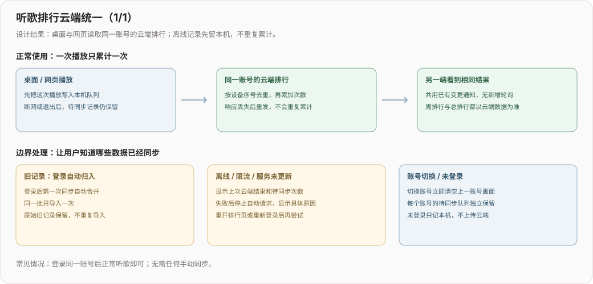

# 听歌排行（2026）

## 2026-10-22 refactor(ranking): 未登录不显示听歌排行

**效果**：未登录时侧边栏不再出现「听歌排行」入口；页面标题下不再显示「未登录 · 仅本机记录」「云端排行 · 已同步」「N 次待同步」等说明小字，只剩标题、时间范围切换和榜单。登录后桌面与网页的自动同步行为不变

**边界**：同步真正失败时仍保留一条红色错误提示，不静默吞错

## 2026-10-22 feat(ranking): 听歌排行登录后全自动同步，去掉手动入口

**效果**：登录同一账号即自动同步，排行页不再有「同步排行」按钮和「合并到当前账号」确认。旧记录与未登录期间的播放在登录后第一次同步时自动归入当时登录的账号，同一批只导入一次，原始旧记录保留

**取舍**：限流或服务异常后仍不自动重试、不定时探测；重新打开排行页、重新登录或重启应用才继续。共用设备登录多个账号时，旧记录归第一个登录的账号。生产环境的 Web 仍是带手动入口的版本，需随下次发布更新；服务端接口无变化

## 2026-10-22 fix(ranking): 云端排行上线并修复首次启动等待

**效果**：同步服务和 Web 已发布。用户缓存首次读取改为等待平台初始化完成，解决已登录但排行一直停在「尚未读取云端排行」的情况；不改变原有缓存格式或账号归属规则

**线上验证**：Chrome 正常播放一首歌曲，云端确认一次播放，另一窗口未刷新就显示相同次数；公网桌面协议接口与服务器落盘记录一致，周榜与总榜一致。原有同步数据逐项校验未变，旧听歌记录未自动合并；登录会话、隧道和歌词对齐服务保留

**边界**：本次发布同步服务和 Web，未更新用户安装的桌面程序。桌面端需升级到包含本次上报逻辑的版本后，才会参与云端排行。新增真实模块启动回归覆盖有缓存和无缓存两种情况；启动链路排障记录见 [初始化就绪约束](../ideas/听歌排行-初始化就绪.md)

## 2026-10-22 feat(ranking): 桌面与网页共用账号云端听歌排行

**效果**：登录同一账号后，两端展示同一份云端周排行和总排行。播放记录先可靠保存在本机，再上报；断网、限流或服务异常时显示具体原因、上次云端结果和待同步次数，不反复自动请求。恢复后重新打开排行页或重新登录自动继续。未登录仅保留本机记录，切换账号不串排行

**旧记录**：登录后自动归入当前账号，无需手动合并；同一批只导入一次，原始旧记录保留。共用设备时旧记录归第一个登录的账号

**关键链路**：沿用歌单的登录凭证、网页服务端代理和变更通知，不新增常驻通道。排行使用独立追加接口，以设备连续序号去重，而不是互相覆盖总次数；服务器落盘后才确认，本机只清掉已确认的记录。浏览器多页签共用一个数据库事务完成读改写，桌面由主进程串行保存；搜索点播等待分 P 身份齐全后再记一次

**验证范围**：本地真实 HTTP 集成覆盖桌面鉴权协议与网页代理、并发去重、账号隔离、落盘重启和通知唤醒。真实页面组件与浏览器存储验收中，两页签各并发写入 20 次，总计正确增加 40 次；故障时新增的 2 次刷新后仍保留，恢复同步后只增加 2 次。Electron IPC 与移动端持久化另有回归测试。未部署生产，未进行打包桌面版和手机真机验收

发布顺序、边界与回归入口见 [听歌排行云同步](../sync/听歌排行云同步.md)。
