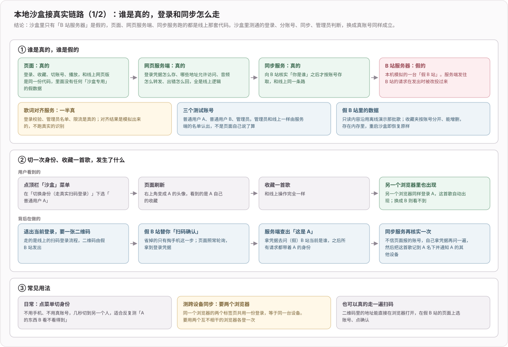
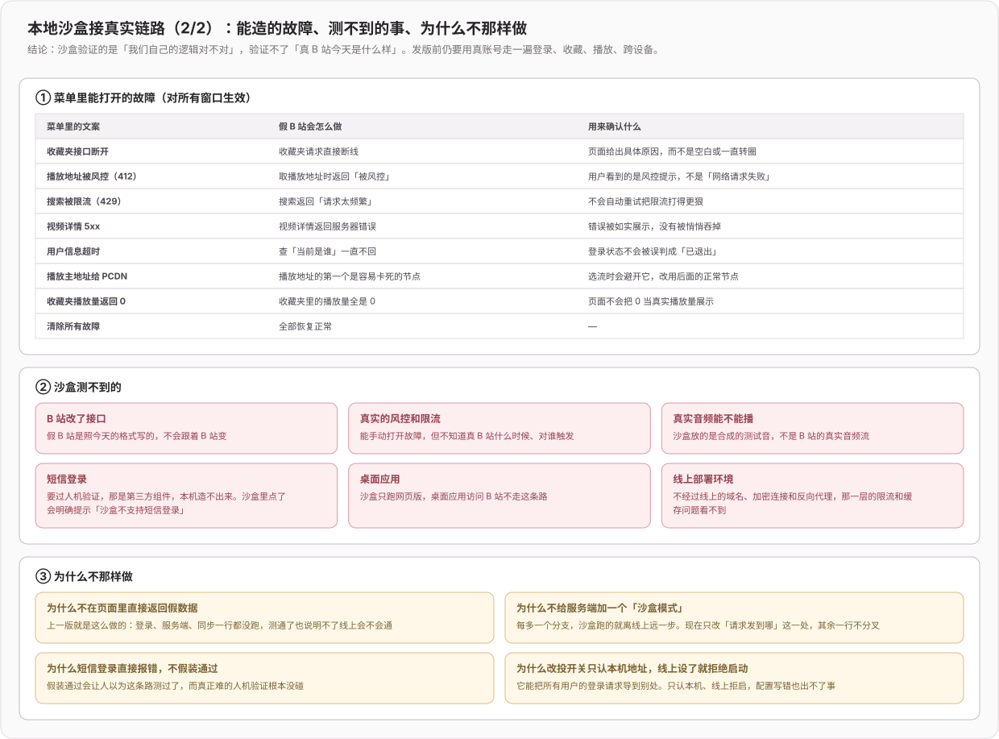

# 开发工具与性能（2026）

> 专题开发日志。新记录在上；记录规则和总入口见 [`DEVLOG.md`](../../DEVLOG.md)。

## 2026-11-10 feat(sandbox): 沙盒只替换 B 站这一层，登录、服务端和同步都跑真实代码

**效果**：`pnpm sandbox` 现在跑的是真实的网页版页面、真实的网页服务端和真实的同步服务，只有「B 站服务器」换成本机模拟的假 B 站。顶栏「沙盒」菜单切换身份时走的是真实扫码登录流程（假 B 站代替手机确认），所以登录后才能用的功能、分账号、跨设备同步、管理员入口都能在本机测，测通的逻辑换成真账号同样成立。同一个菜单还能打开假 B 站的故障（接口断开、风控、限流、服务器错误、超时、卡流节点、播放量为 0），用来检查出错时页面怎么表现

**关键数据流**：

1. [`scripts/sandbox.mjs`](../../scripts/sandbox.mjs) 起四个进程：假 B 站（3010）、同步服务（3012）、mock 模式的对齐服务（3013）、内含真实 BFF 的 Web dev（5679）。同步和对齐服务共用一个每次启动随机生成的签名密钥，数据在 `~/.biu-sandbox`，`--reset` 清空
2. 设了 `BIU_SANDBOX_UPSTREAM_ORIGIN` 时，BFF 和同步服务把发往外部域名的请求改投到假 B 站（[`web-server/sandbox-upstream.ts`](../../web-server/sandbox-upstream.ts)）。只改出站地址，放行名单、Cookie 域校验、媒体 token、错误处理都照真实域名走。这个变量只认本机回环 http 地址，`NODE_ENV=production` 下设了直接拒绝启动
3. 假 B 站（[`scripts/sandbox-bilibili/`](../../scripts/sandbox-bilibili/)）提供扫码登录、当前用户、按账号分开且可增删的收藏夹、视频详情、播放地址（返回形似真实 CDN 的地址，再由它自己提供支持 Range 的合成音频）和网易云歌词；其余只读接口沿用离线 Demo 的数据
4. 渲染层去掉了第一版的全部沙盒短路（假用户、假数据适配器），`src/common/sandbox-fixtures.ts` 删除；沙盒构建不再算离线 Demo，而是普通 Web 构建加一个只转发「确认登录」「读写故障开关」的控制中间件（[`plugins/sandbox-dev.ts`](../../plugins/sandbox-dev.ts)）

**边界**：短信登录要过第三方人机验证，本机造不出来，沙盒里会明确提示不支持。沙盒只跑网页版，不覆盖桌面应用和线上部署环境；假 B 站按当前接口格式编写，B 站改接口、真实风控和真实音频流仍要用真账号验证。生产环境不设这个变量时，两个服务端的行为没有变化

**验证**：[`tests/sandbox.test.ts`](../../tests/sandbox.test.ts) 5 个用例经真实 BFF 入口和假 B 站端到端跑通（扫码登录、按账号隔离、退出、带媒体 token 播放并丢弃卡流节点、故障注入），拆掉改投后变红。浏览器实测：A 收藏一首歌后，另一个独立浏览器里的 A 自动收到；切到 B 看不到 A 的数据；管理员有管理入口、普通用户没有。全量测试仅余 2 项移动端视口失败，与本次改动无关

**已知缺口**：打开「收藏夹接口断开」后，收藏夹页显示「暂无内容」并弹出英文原始报错 `Request failed with status code 502`，没有给出具体原因。这是应用自身的错误文案问题，由沙盒暴露出来，紧接着单独修

## 2026-11-03 fix(sandbox): 搜索不再返回无关歌曲

**效果**：沙盒和离线演示搜索支持按歌曲标题或 UP 主匹配，英文忽略大小写，多词同时匹配；没有匹配内容时显示现有的「暂无内容」，不再无论输入什么都返回整份固定列表。空白搜索仍显示原演示目录，数据只在本地匹配，不请求真实 B 站

**验证**：新增 7 项搜索用例，修改前 5 项失败、修改后全通过；相关沙盒和离线演示回归共 20 项通过，定向 ESLint、格式检查、完整 Web 构建通过。浏览器复验相关查询只显示目标歌曲并可播放测试音频，无匹配查询在桌面及 390×844 视口显示空结果，刷新后播放队列保留。全量类型检查在原件与修改后均报告相同的 202 项既有诊断，本次涉及文件没有新增诊断

**边界**：只改本地演示数据的匹配，不替代真实搜索排序或第三方数据质量验收；没有修改生产接口、登录规则或部署

## 2026-10-27 feat(dev): 新增不依赖 B 站账号的本地沙盒

**效果**：`pnpm sandbox` 一条命令起本地沙盒，打开 http://localhost:5679 就能测，不用登录 B 站、不碰真实账号。顶栏中间的「沙盒」菜单一键切换未登录 / 普通用户 A / 普通用户 B / 管理员，不用重启、不用签 token。第一期覆盖播放、歌词显示、自动逐字对齐、报错、管理员审核和「我的提交」，上一轮审核流程的整套测试可以完全在沙盒里跑。设计见 [`docs/ideas/008-本地沙盒测试.md`](../ideas/008-本地沙盒测试.md)

**关键数据流**：

1. [`scripts/sandbox.mjs`](../../scripts/sandbox.mjs) 同时起 mock 模式的对齐服务和 `BIU_TARGET=sandbox` 的 Web dev，每次启动随机生成签名密钥传给两边；对齐服务的数据放在 `~/.biu-sandbox`，`--reset` 清空。
2. B 站请求沿用离线 Demo 的假数据，沙盒只改写几处（[`src/common/sandbox-fixtures.ts`](../../src/common/sandbox-fixtures.ts)）：当前登录用户跟随所选身份，播放地址指向 dev 服务器合成的 60 秒音频，歌词渠道返回固定歌词；「Live Session」那首模拟查无歌词。
3. 对齐请求走线上同一个 Web 转发代码（放行名单、登录检查、错误文案都是真的），只把「用 B 站登录换 token」换成 dev 中间件按身份 cookie 直接签（[`plugins/sandbox-dev.ts`](../../plugins/sandbox-dev.ts)）。
4. 沙盒独占 5679 端口：有些 store 存在不带前缀的 localStorage 里，和 `dev:web` 同源会共用播放列表；独立源后「清空本页数据」可以整源清空，不会误删真实开发数据。

**边界**：沙盒只能 dev，不能出构建产物；正式 Web 构建产物里已确认不含沙盒代码。同步、手机端、Electron、故障注入留到之后按需做。离线 Demo 的行为不变（只把假 BV 号补到和真实一样的 10 位）。

**验证**：沙盒新增 9 个用例通过；全量 Vitest 只剩基线已有的 2 个移动端布局用例失败。浏览器实测：普通用户 A 播放 → 自动对齐 → 报错，切到管理员 → 审核页重新对齐对照 → 用重跑结果替换，切回 A →「我的提交」显示「已换成管理员重新对齐的版本」；未登录被拒、普通用户看不到审核入口、查无歌词显示「暂无歌词」都确认过。未验证：Windows 上的启动脚本。

## 2026-08-29 feat(desktop): 通过 Umami API 上报匿名活跃数据

**效果**：桌面应用生产版启动、重新激活或被第二实例唤回时，会向 Umami 记录一次桌面活跃事件；窗口频繁切换最多每 5 分钟上报一次，网络失败不会阻塞应用启动。

**关键数据流**：

1. [`electron/analytics.ts`](../../electron/analytics.ts) 在主进程直接调用 Umami `/api/send`，携带站点 ID、固定桌面路径、版本、操作系统、架构和触发来源；不主动发送账号、歌单、搜索词或播放内容，并缓存 Umami 返回的会话 token。
2. [`electron/main.ts`](../../electron/main.ts) 在 `app.whenReady`、macOS `activate`、窗口重新获得焦点和第二实例唤回时触发上报；开发模式跳过生产看板，所有请求都以 `void` 方式异步收口。
3. [`shared/umami.ts`](../../shared/umami.ts) 与 Web 生产构建共用 Umami host/site ID，避免网页脚本与桌面 API 指向不同站点。

**验证**：Umami 上报单测 3 项、启动/平台回归 18 项通过；`BIU_TARGET=web pnpm exec rsbuild build` 成功，桌面 `pnpm build` 已完成主进程与渲染层编译，但 electron-builder 随后因仓库既有缺失的 `electron/python/shazam_recognize.py` 和本机构建产物重命名问题失败。

## 2026-08-08 perf(eslint): 避免全仓检查扫描生成文件

**效果**：

1. 全仓 ESLint 不再扫描服务端 `dist`、嵌套 `node_modules` 与 Android 构建产物，避免生成文件把一次检查拖成长期高 CPU 进程。
2. 编辑器 ESLint 改为保存时检查，并固定在仓库根目录解析配置，减少持续检查与子目录重复解析。

**关键配置**：

1. [`eslint.config.mjs`](../../eslint.config.mjs) 使用全局忽略规则覆盖所有层级的 `dist` / `node_modules` 和 `android` 生成目录；源码目录仍按原规则检查。
2. [`.vscode/settings.json`](../../.vscode/settings.json) 设置 `eslint.run: onSave` 与根目录工作目录；不改变手动 `pnpm exec eslint` 的使用方式。

**验证**：同一条 `pnpm exec eslint .` 从修改前约 2 分 48 秒降至约 6.3 秒；生成文件直接检查会被忽略，命令结束后无 ESLint 常驻进程。
