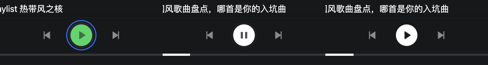

# 快捷键焦点反馈（2026）

> 专题开发日志。新记录在上；记录规则和总入口见 [`DEVLOG.md`](../../DEVLOG.md)。

## 2026-11-04 fix(player): 键盘与读屏可识别播放栏操作

**效果**：共享播放控件的三个图标按钮现在分别具有「上一首」「播放 / 暂停」「下一首」名称，播放状态切换时同步更新名称；桌面播放栏和复用该控件的全屏播放器一起生效。与已有手机播放栏命名保持一致，不增加悬停依赖或界面说明文字。

**边界与验证**：原有切歌、播放动作及空队列 / 单曲禁用规则不变。新增组件回归覆盖暂停、播放、空队列及多曲操作；修改前四项失败，修改后通过。浏览器验收与真实读屏设备验收分开记录，不把语义名称检查当作真实设备通过。验收截图已检查真实文件格式与解码像素，格式修正没有改变画面。

## 2026-07-27 fix: 键盘操控触发导航焦点

**效果**：1图是旧实现按空格后的蓝圈；2图是修复后空格进入暂停；3图是随后按空格恢复播放且无蓝圈。

**关键代码**：

1. [`src/app.tsx`](../../src/app.tsx) 在 capture 阶段监听 `pointerdown / focusin / pointerup`，把焦点来源交给 `createPointerFocusGuard()`；`keydown` 在 React Aria 处理前调用 `releaseForKeyDown()`。空格在页面背景或鼠标遗留焦点上始终调用播放器 `togglePlay()`，所以焦点回到 `BODY` 后连续按空格仍会持续切换；已配置快捷键释放焦点后走统一动作，不会重复触发。
2. [`src/common/utils/focus.ts`](../../src/common/utils/focus.ts) 只记录 pointer 期间得到焦点的非输入元素。Tab 产生的焦点不会进入 `pointerFocusedElement`，所以正常键盘导航及其蓝色焦点提示仍保留；`input / textarea / select / contenteditable` 继续排除。
3. [`tests/focus.test.ts`](../../tests/focus.test.ts) 覆盖三条边界：第一次空格释放鼠标焦点并进入播放快捷键路径；焦点已在 `BODY` 时后续空格仍进入同一路径；Tab 来源焦点 + 空格不走全局播放快捷键。
