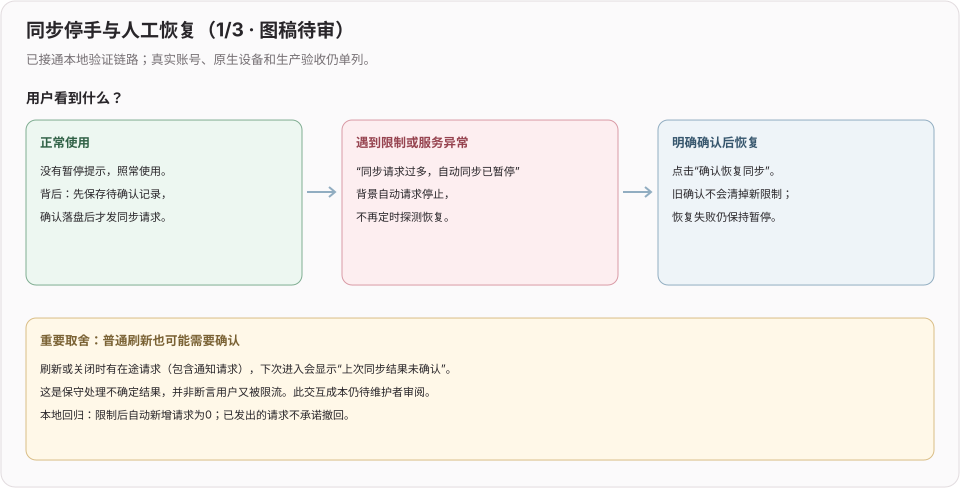
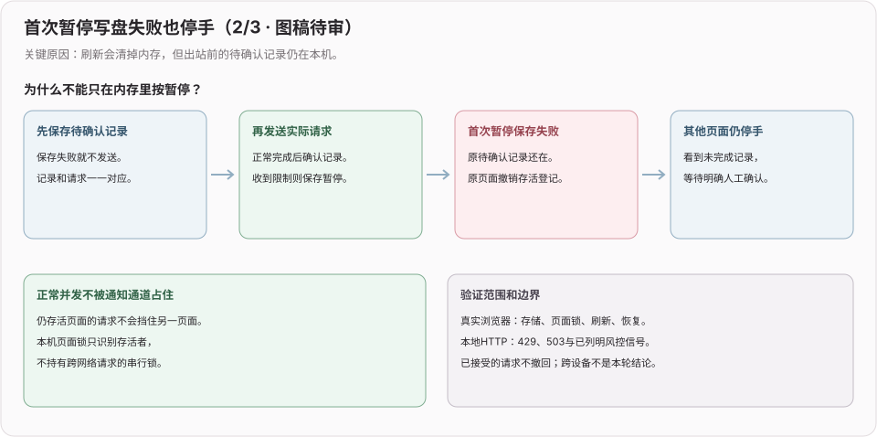
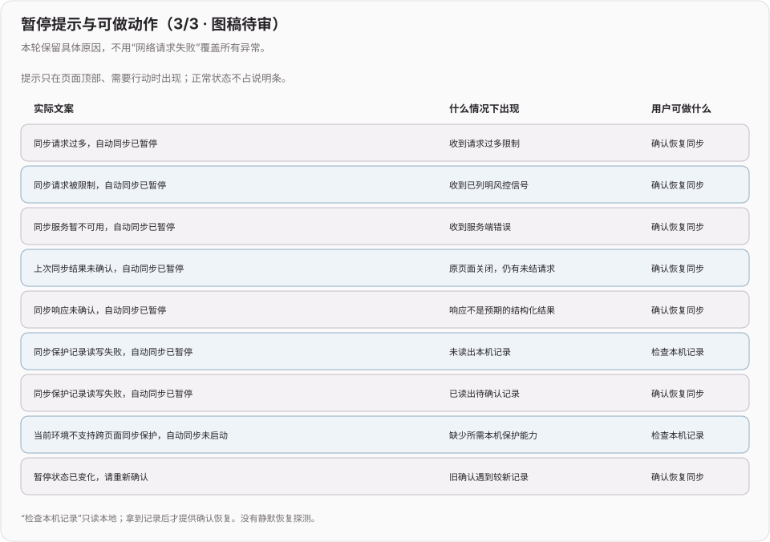
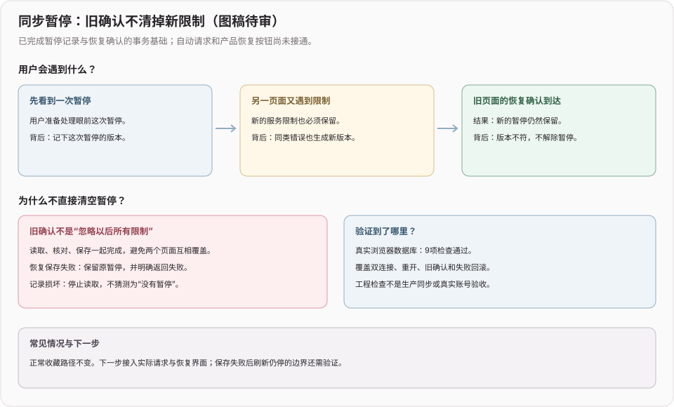
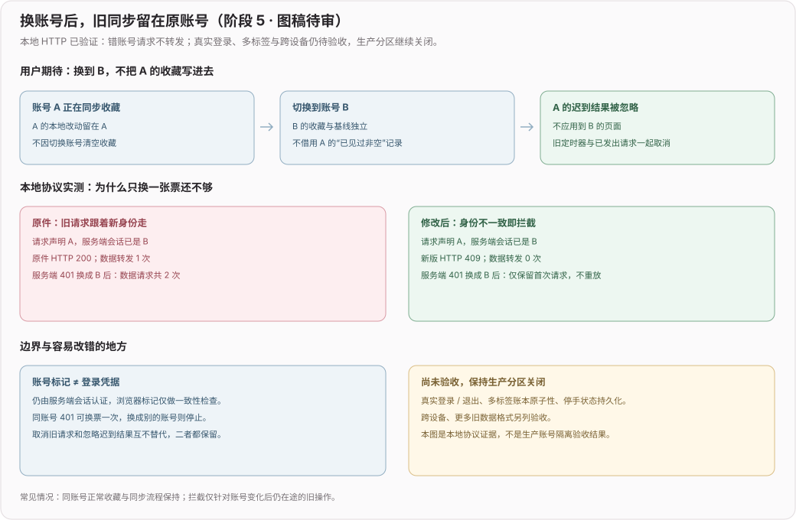
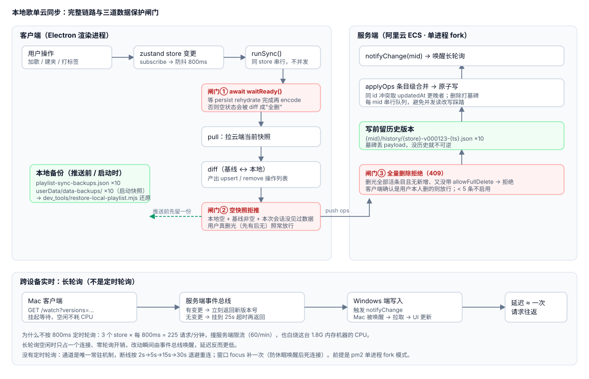
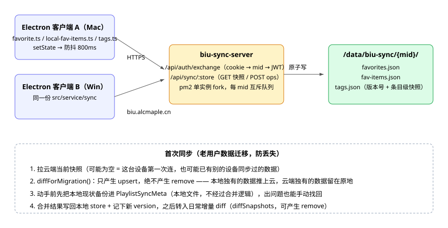

# 本地歌单云同步（2026）

> 专题开发日志。新记录在上；记录规则和总入口见 [`DEVLOG.md`](../../DEVLOG.md)。设计取舍和事故复盘见 [`docs/ideas/004-本地歌单云同步.md`](../ideas/004-本地歌单云同步.md)。

## 2026-11-09 fix(sync): 限制后停止自动请求并提供明确恢复

**效果**：同步HTTP遇到429、已列明风控信号或5xx后停止后续自动请求；换票不吞暂停错误，通知退出退避，排行沿用同一闸门。原页面只在异常时显示具体原因和「确认恢复同步」，普通状态不占说明条。

**失败边界**：出站意图先落盘；首次暂停写盘失败也保留未结记录，撤销原页面存活登记，其他页面与刷新后继续停手。存活页面间不串行等待网络。同账号恢复保留真实删除见证；旧确认、迟到查询、恢复保存失败不会清掉新暂停。

**验证**：补齐静态演示测试上下文的显式类型字段。32项新增、225项相关回归；loopback HTTP的受限后自动新增请求0次，明确恢复后才重新允许。真实浏览器验证IDB/页面锁、另一页面、刷新和原React恢复按钮；合成身份/数据/故障，不是真人或线上验收。类型206条既有诊断无新增；Layout原有lint警告单列。

**产品取舍待审**：刷新时有在途请求（含常驻通知）也会要求确认，可能较常见，频率未实测；Web Locks不支持时停止同步。已发请求不撤回，原生实机与多设备待验。生产分区不开启，未合并部署。

  

## 2026-11-09 feat(sync): 暂停记录支持版本确认与原子恢复

**已完成能力**：暂停记录每次更新递增版本，旧确认不解除新限制；Web读取、比对与保存同一事务，恢复失败回滚；Electron固定IPC由主进程排队，读写异常返回调用方。状态跨存储重开保留，不因时间经过自动解除。

**验证**：28项新增、193项相关回归通过，真实浏览器9项事务检查通过；正常原页面跨轮保留梦醒时分收藏，57秒续播循环后刷新48秒；独立新用户续集保存找回播放刷新29秒。工程数据和真实用户数据分别归因，Electron存储为测试替身。

**未启用的行为**：请求/通知/排行闸门及产品恢复入口尚未接通；首次限制写盘失败后的刷新停手机制仍需补验。没有据本轮能力宣称自动停手完成，生产分区继续关闭。

## 2026-11-08 fix(sync): 备份未保存成功时停止本次推送

**效果**：同步基线或滚动备份读写失败不再当作成功；滚动副本保存失败时，本次不推送、不应用远端、不推进基线。备份队列仍可接收后续独立操作。

**边界**：Web 的这两类记录要求 IndexedDB 可用，读事务提交后才返回；存储故障不回退到可能为空的另一份数据。Electron 写盘失败和被较新写入替代均向调用方报告失败，文件锁等待后再次核对顺序，避免旧记录覆盖新记录。普通偏好保存路径不变，无新 IPC 能力或数据迁移。

**验证**：新增 15 项，相关 165 项通过；同组 37 项原件 12 失败 / 25 通过，修改后全过。存储故障与 IPC 使用隔离替身，不等于真实磁盘满或设备验收。原页面新用户保存、找回、播放与刷新 57 秒通过，修改后同来源内容仍在；原件/修改后 Web 构建通过，类型同为 206 条既有诊断、退出 2、无新增。

**仍未完成**：这只是持久化停手的存储前置修复，不是 429/风控/5xx 人工恢复状态、多标签事务或真实身份验收。生产分区仍关闭。

## 2026-11-06 fix(sync): 换账号不再重放或应用旧身份的同步操作

**已完成代码**：控制器捕获账号和会话世代，换身份清旧定时器、版本提示与非空见证；客户端取消在途请求并丢弃迟到结果，同账号 401 仅换票一次；Web BFF 复查期望账号及内部换票后的身份。三个 store 的基线和滚动副本在同一上下文内串行重读更新，避免相互覆盖。日志不携带 HTTP 凭据配置。

**本地实测**：会话已 B 而请求仍 A，原件 200/转发 1 次，新版 409/转发 0 次；BFF 自身 401 换成 B 后，原件重放、新版不重放。新增 22 项契约回归，相关 150 项通过。原页面新会话完成搜索、保存、找回、播放与刷新保留，长期通勤角色原队列保留。类型原件/修改后仍 206 条相同诊断、退出 2，无新增。

**边界**：这是本地协议与共享代码保护，不是生产账号隔离完成。真实登录/退出 UI、多标签持久化原子性、429/风控/5xx 停手状态持久化与跨设备仍未验收，生产分区开关继续关闭。已完成部分与后续门槛见[阶段 5 方案](../ideas/访客本地红心歌单入口-待审.md)。未迁移真实数据、合并或部署。

## 2026-08-04 perf: 一次操作只发一个请求

**效果**：一次用户操作的请求数从约 17 降到 **1~2**；空闲时每设备约 **1.2 次/分钟**。为多用户并发留出余量——限流是自家服务端的 `express-rate-limit`（按 mid），跟 B 站无关，同步全程不碰 B 站接口。

**省掉的三处**：

1. **推送前那次拉取**——推送的响应本身就返回合并后的完整快照，先拉一次纯属浪费。现在三种情况互斥：有本地变更只 push；无变更但云端更新只 pull；两边都没动一个请求都不发。
2. **自己推送的通知回声**——推送成功后服务端广播，本机挂着的通道会被自己叫醒，那条通知携带的正是自己刚写上去的版本号。控制器记住 `lastSyncedVersion`，认出回声直接跳过。
3. **“要不要拉”的确认请求**——通知通道返回的版本号直接交给控制器当判据，不必再打一个请求去问云端。

另外把长轮询挂起上限从 25s 延到 50s（受反代 `Timeout 300` 约束，余量充足），空闲请求量再减半。

## 2026-08-04 fix: 同步一次快一次慢

**根因是服务端限流 + 客户端请求放大**，从 Apache 访问日志查到的：两分钟内 **58 个请求被 429 拒绝**。

限流按 mid 算，两台设备共用同一个账号的 60 次/分钟额度；而一次“创建歌单”实际会打约 17 个请求——`syncAllNow` 无脑跑三个 store、`applyRemote` 写回本地又触发订阅再排一轮、每轮还都先拉后推。连做三四次操作就打满额度，之后所有请求被拒、退避等待，表现为“一次快一次慢、连改几次就不动”。

**改法**（请求量降到约 1/5）：

1. 通知只叫醒**版本号真的变了**的那个 store，不再三个全跑——服务端返回的 `versions` 已经精确指明是谁变了。
2. `applyRemote` 期间屏蔽自身订阅触发的同步——那轮数据刚从服务端拿到，再同步一次纯属空转。
3. 服务端：`/watch` **移出限流**（它是实时的唯一通道，被 429 拒掉等于功能死掉），额度 60 → 600。
4. 服务端所有响应加 `Cache-Control: no-store`——`res.json()` 默认带 ETag，日志里长轮询全是 **304**，客户端拿到的是浏览器缓存副本而不是本次真实结果。

**同时修掉的次要问题**：该域名启用 HTTP/2（`Protocols` 只写在 biu 的 vhost 里，不影响同机其他十几个站点）。长轮询会占住一条连接 25s，HTTP/1.1 下 Chromium 每域名只有 6 条连接，同步请求会排队——这是真实存在的隐患，但**不是这次的主因**，最初把它当根因是误判。

客户端另补：通知通道的失败原来被 `.catch(() => null)` 静默吞掉，一行日志都没有，排查时完全是黑盒——现在失败、重连、每轮挂起时长都有日志。传输层失败后补一次重试；一轮同步超过 3s 打日志。

## 2026-08-04 perf: 跨设备同步从 3s 降到 0.8s

**效果**：一端改动到另一端看见约 **0.8s**（原 2~3s）；连续快速收藏不再“卡住不同步、停手后一次性全到”。

**两个原因**：

1. **两处防抖叠加**——接收端被 `/watch` 通知唤醒后又走了一遍 800ms 防抖。防抖是为合并用户连续操作，被通知唤醒时没有后续变更要合并，这 800ms 纯属白等。外部触发（通知 / 登录 / focus）改走 `syncNow()` 不排队。
2. **纯防抖被连续操作饿死**——每次变更都重置计时器，操作间隔小于防抖时长时推送被无限顺延。加 `SYNC_MAX_WAIT_MS`：距第一次未处理变更超过 1.2s 就强制推。发送端防抖同时从 800ms 降到 400ms。

## 2026-08-04 fix: 同步把本地歌单数据清空

**效果**：修复 2.5.0 的数据丢失事故（云端歌单夹被删空）；补上跨设备实时同步；本地 + 服务端各留 10 份数据快照。

**两个根因**：

1. **状态未就绪就 diff**——store 是 zustand `persist`，rehydrate 走 IPC 读盘是异步的，同步只等了 800ms 防抖。冷启动排队超时就拿到空状态，被 diff 成“全部删除”推上云；服务端墓碑丢弃 payload，云端不可逆。
2. **同步是单向的**——`pullSnapshot` 只在首次迁移调过一次，之后本机无变更就直接 return，从不拉取。表现为“另一台设备改了，这台等一天都不动，重新登录才生效”（重登重走迁移分支）。

**改法**：见上图三道闸门 + 每次先拉后推；跨设备实时改用长轮询（`/watch` + 进程内事件总线），不用定时轮询。

## 2026-08-02 feat: 本地歌单云同步

**效果**：本地创建的歌单夹（`favorites`）、歌单内歌曲（`fav-items`）、标签（`tags`）三个持久化文件，此前只能靠用户自己用百度网盘同步目录做整文件同步——网盘低性能模式不实时、两端同时改动会整文件互相覆盖。现在按 B 站登录 `mid` 分用户，接一个部署在阿里云 ECS 上的轻量同步服务（`biu-sync-server/`），条目级增量合并，不再有整文件覆盖的丢数据风险。设计取舍见 [`docs/ideas/004-本地歌单云同步.md`](../ideas/004-本地歌单云同步.md)。已用真实账号实测：新建歌单夹 + 加两首歌后，`https://biu.alcmaple.cn` 后端 `/data/biu-sync/{mid}/` 下的 `favorites.json` / `fav-items.json` 数据与客户端一致。
