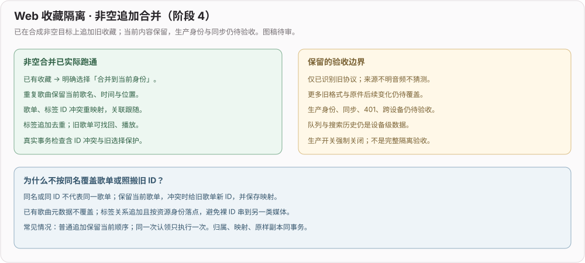
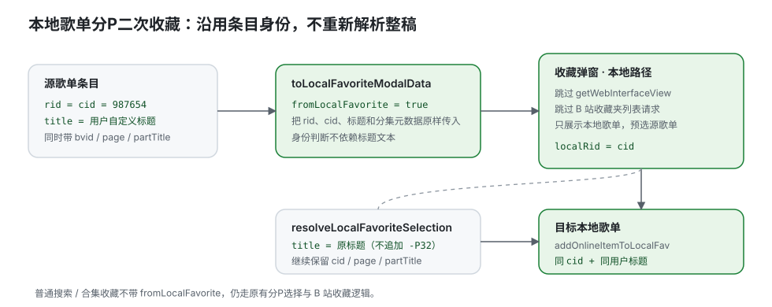

# 本地歌单收藏（2026）

> 专题开发日志。新记录在上；记录规则和总入口见 [`DEVLOG.md`](../../DEVLOG.md)。

## 2026-11-05 feat(favorite): 沙箱旧版收藏可明确恢复到空身份

**已完成**：旧 Web 收藏在预览中不再只有启动阻断。用户可暂不恢复并从头像再次打开，或明确恢复到当前空身份；目标、归属和原样副本单事务提交，未分区原件保留，不自动分给账号或访客。同账号幂等，其他账号不重复认领，非空目标不覆盖。

**实际验证**：合成旧样本的自建歌单、红心、自定义歌名/歌手和标签保留，播放、刷新和换账号后关系正确；同一原件回放旧版本仍显示旧保护文案。新增8项回归，相关93项通过；8项恢复真实IDB检查和9项原分区检查通过，含归档写入失败整体回滚。类型206条相同、无新增，lint/格式和正式Web构建通过。

**边界**：仅已识别旧协议和空目标，生产仍强制关闭；非空合并、更多格式、生产身份同步、访客自建夹入口等未验收，不记为完整升级或生产账号隔离完成。原角色历史和真实用户数据未迁移。取舍见[阶段3方案](../ideas/访客本地红心歌单入口-待审.md)。

## 2026-11-05 feat(favorite): 沙箱分区预览接入原收藏页面与并入选择

**已完成的预览**：原页面等待身份与三个个人 store 就绪后再展示收藏；可见切换先等写盘再重载。登录时明确「并入 / 不并入」，按上阶段规则保存决定；并入后保留在线收藏夹，访客原件不变。启动默认红心的初始化顺序、并入时在线收藏夹保留，均在实际试跑中校正并补回归。

**实际路径**：同一来源访客保存、A不并入并另存、访客找回、B并入、A重登、访客新增再询问、B去重追加与刷新播放均复验。新增16项回归，相关85项通过；真实IndexedDB的9项工程检查增加了“已开始事务后关闭会话”的覆盖。

**仍未完成**：生产与旧数据归属/恢复、真实退出和同步/401/跨设备尚未接入，设备级队列/搜索历史不在本次隔离范围。预览只在全新沙箱数据中显式启用，正式Web构建即使设置开关也不启用；未迁移或删除真实用户数据。

**检查口径**：类型原件/修改后相同206条、无新增；改动代码lint通过，Layout保留1条原件同样存在的警告；正式Web构建与入口文案扫描通过，不宣称全量类型或生产隔离验收通过。设计与未完成门槛见[当前阶段方案](../ideas/访客本地红心歌单入口-待审.md)。

## 2026-11-05 feat(favorite): 增加 Web 账号分区与显式并入的存储基础

**已完成**：新增账号 / 访客独立的 IndexedDB 分区模块，关闭会话后拒绝迟到操作；仅明确选择后向目标红心追加歌曲，歌曲和选择一次提交，失败保留访客原件。资源身份与标签共用纯函数，原有标签键行为不变。

**范围**：本阶段未接入产品登录、弹窗或旧数据认领；当前界面仍使用原存储，不记为“账号隔离已完成”，也未自动迁移真实用户数据或改变云同步协议。

**验证**：18 项新单测，相关回归共 60 项通过；真实浏览器 IndexedDB 工程检查 9 项通过，含并发连接、事务回滚与损坏记录保护。ESLint、格式与正式 Web 构建通过；最新基线和修改后全量类型同为 206 条诊断，无新增。详细边界和下一阶段见[评审方案](../ideas/访客本地红心歌单入口-待审.md)。

## 2026-11-04 feat(favorite): 访客保存歌曲后可从菜单找回

**效果（提案待审）**：未登录时增加与收藏弹窗同名的「我喜欢的音乐」入口，直接打开已有本地红心歌单。桌面侧栏、平板图标轨与手机侧栏抽屉共用同一菜单；登录后仍沿用原收藏夹分组，不重复增加入口。

**边界**：只补可见导航，不改收藏写入、账号归属、持久化或云同步规则，不开放在线收藏夹和创建入口。原有隐藏菜单偏好继续生效；本阶段只覆盖默认红心歌单，其他自建本地歌单入口未扩展。

**验证**：新增组件回归覆盖访客展开 / 折叠、登录后去重、隐藏偏好与登录态切换；旧实现 4 项失败、3 项通过，修改后 7 项全过，相关定向回归共 15 项通过。桌面与 390px 手机完成保存 → 离开 → 找回 → 播放路径复验，900px 平板确认图标入口能找回同一歌曲；两个既有视口静态断言在原件与修改后同样失败，单列跟进，不声称全部测试通过。真实服务与设备不冒充已验收。产品取舍见[待审方案](../ideas/访客本地红心歌单入口-待审.md)。

## 2026-10-24 feat(favorite): 失效自动找同名替换

**效果**：打开本地歌单时，歌单里新发现的失效视频会自动去 B 站找同名视频替换，歌名和时长（相差 15 秒内）都对得上才换，其余不动。原来的「失效内容」按钮改成「失效记录」，每条记录显示「原标题 → 新标题」和状态：已替换（可「换一个」「撤销」）、待处理（可「自己搜索」「删除」）、搜索出错（可「重试」）。「换一个」不会重复给出看过的视频，找不到更多可信的就还原成失效项，交给用户自己搜索。「自己搜索」直接在弹窗里列出搜索结果，点「替换」就顶替对应的失效项，不会留下卡住的待处理记录

**异常边界**：每个失效视频只自动尝试一次，搜索被拦截或失败时立刻停手、记为「搜索出错」并写明原因，只有用户点「重试」才会再搜；失效视频多时排队逐个处理，相邻两次搜索至少间隔 2 秒。对应视频已不在歌单、或失效项自己恢复有效时，记录自动清理。替换目标已在歌单时只移除失效项

## 2026-09-12 perf(favorite): 复用分集信息减少收藏等待

**效果**：播放已经取得视频详情后再收藏，不再重复等待一次分集请求；单集直接展示收藏夹，多集保留选集步骤。播放详情尚未返回时，收藏等待同一个进行中的请求。既有本地条目仍沿用原身份，不进入在线查询。

**关键链路**：视频详情成功 → 按账号与 bvid 保存分集元数据 → 收藏同步读取；未命中时复用进行中请求或发起一次请求 → 返回后进入单集/多集对应步骤。缓存只在页面内存，5 分钟过期、最多 100 份，不缓存完整用户响应、播放地址或失败结果；原详情接口调用仍正常请求，不让其他功能读到缓存的动态信息。

**异常边界**：冷请求仍受上游延迟影响，不承诺固定秒数。业务错误、空分集或网络失败展示“分集信息加载失败，请重试”，不自动重试，也不将未知分集当作单集继续保存。关闭或切换视频后，旧请求迟到不更新当前弹窗。

**验证**：旧弹窗在“播放详情已取得后再收藏”的回归中请求 2 次，修改后总计 1 次（收藏新增请求为 0）；React DOM 验证命中缓存时不显示加载占位、保留多集选择、迟到响应隔离及手动重试。分集缓存、收藏、标签与播放队列共 55 项测试通过，ESLint 和 `pnpm run build:web` 通过。未部署生产，未将测试执行时间当成真实网络耗时提升。

## 2026-09-12 fix(favorite): 统一播放栏与歌单列表的收藏和标签状态

**效果**：播放栏和播放队列的收藏入口优先复用已有本地条目，打开时勾选已有歌单，沿用自定义标题、分集与标签；复制到另一个歌单后再次打开，已有收藏不再被当成新稿件重复添加。

**关键链路**：播放项 → 按来源/类型匹配本地条目（视频优先 bvid + cid，未命中分集再匹配整稿；本地文件与在线音频隔离）→ 与列表共用 `toLocalFavoriteModalData` → 同一个 rid/cid 决定歌单勾选、标签读写与保存。未收藏的在线资源继续原有在线选集流程，不把当前播放 cid 强行写成分集收藏。

**关键修复**：`music-fav-button`、`music-playlist-drawer` 复用 `toPlaybackFavoriteModalData`；星标本地匹配也使用同一规则，避免同视频其他分集误点亮。收藏弹窗从首次打开就依据原条目的 cid 计算标签目标，不依赖上一次关闭弹窗留下的选集状态。

**验证**：旧弹窗在首次打开分集时复现标签缺失；修改后 React DOM 交互验证已有勾选、分集标签、复制、重开与重复提交禁用。收藏身份、分集/来源隔离、既有标签和播放队列回归共 46 项通过，改动文件 ESLint 与 `pnpm run build:web` 通过。本次未修改或自动清理历史重复条目、未改云同步数据协议，未部署到生产。

## 2026-09-04 fix(tags): 按资源身份稳定绑定歌曲标签

**效果**：

标签按歌曲的稳定资源身份读取和保存，列表排序、增删和筛选不会改变归属。整稿视频、视频分集、在线音频和本地文件使用独立键；播放栏缺少 avid 时由合法 bvid 推导，避免多个视频落入同一个空 id。

**关键代码**：

`src/store/tags.ts` 增加规范化标签键：视频使用 bvid（分集追加 cid），音频使用 sid，本地文件使用文件 id；旧版裸 rid 仍可读取，下一次显式编辑时收敛到规范键。收藏弹窗、远程收藏夹和本地歌单筛选统一使用同一键生成逻辑。

`src/common/utils/bv.ts` 提供安全的 bvid→avid 推导，`src/components/music-fav-button/index.tsx` 不再把缺失的 aid 写成 `undefined`。新增 `tests/tag-song-binding.test.ts` 覆盖跨类型/分集隔离、旧数据读取和播放栏 id 补全。

**验证**：`pnpm exec vitest run tests/tag-song-binding.test.ts tests/playlist-sync-codec.test.ts tests/local-fav-duplicate.test.ts`（16 tests passed）；`pnpm run build:web` 通过。

## 2026-09-04 fix(local-favorites): 隐藏本地歌单头部用户信息

**效果**：

本地歌单头部只保留封面、标题、简介和内容数量，不再显示没有实际归属信息的头像与用户名；在线收藏夹、视频合集和视频系列仍会显示对应 UP 主信息。

**关键代码**：

`src/pages/video-collection/header/index.tsx` 仅在收到 `upMid` 时渲染用户信息，避免通用头部被本地歌单复用时出现空用户占位。新增 `tests/local-playlist-header.test.tsx` 覆盖本地隐藏和在线保留两种状态。

**验证**：`pnpm exec vitest run tests/local-playlist-header.test.tsx`（2 tests passed）。

## 2026-08-07 fix(favorite): 本地歌单分P二次收藏沿用原条目

**效果**：

1. 从本地歌单条目的“移动”菜单再次收藏时，直接进入本地歌单选择，不再弹出整稿分P列表；源歌单会按当前条目状态预选。
2. 分P条目使用已保存的 `rid/cid` 做身份匹配，不依赖歌名；复制到另一个本地歌单时保留用户已经修改过的标题、分集序号、分集标题和时长，不再自动追加 `-P32`。
3. 搜索、合集、播放栏等全网收藏入口不带本地来源标记，仍保留原来的 B 站分P选择和在线收藏逻辑。

**关键数据流**：

1. [`src/common/utils/fav.ts`](../../src/common/utils/fav.ts) 的 `toLocalFavoriteModalData` 将本地条目的 `rid/cid/title/page/partTitle` 与 `fromLocalFavorite` 一起传给弹窗；`source` 同时补齐，避免本地文件二次收藏丢失播放来源。
2. [`src/components/favorites-select-modal/index.tsx`](../../src/components/favorites-select-modal/index.tsx) 看到 `fromLocalFavorite` 后跳过 `getWebInterfaceView` 和 B 站收藏夹列表请求，只计算本地歌单的选中状态；`resolveLocalFavoriteSelection` 以原 cid 为 `localRid`，直接使用原标题。
3. [`src/pages/video-collection/local-favorites/index.tsx`](../../src/pages/video-collection/local-favorites/index.tsx) 的“移动”入口统一走上述本地数据转换；目标歌单仍通过 `addOnlineItemToLocalFav` 入库，因此与普通收藏共享持久化、标签和播放量补全路径。

**验证**：新增 [`tests/local-fav-duplicate.test.ts`](../../tests/local-fav-duplicate.test.ts) 覆盖分P身份/标题保留及普通整稿收藏不误带 cid 两条边界。
