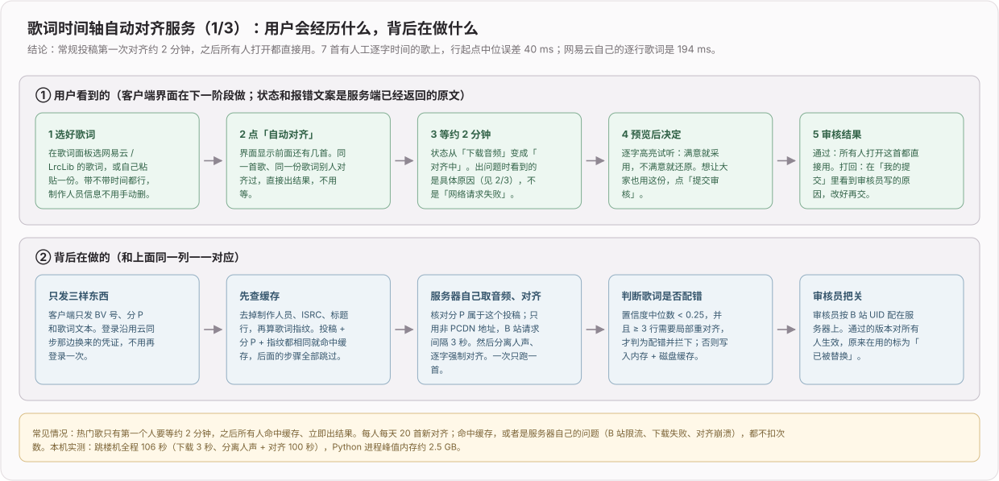
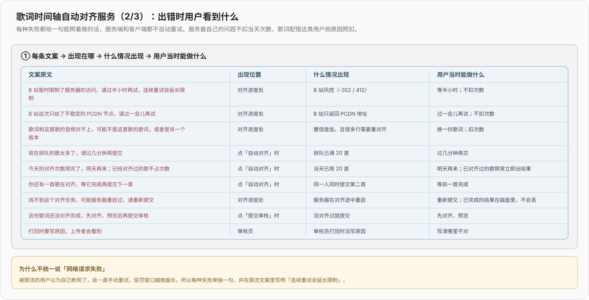
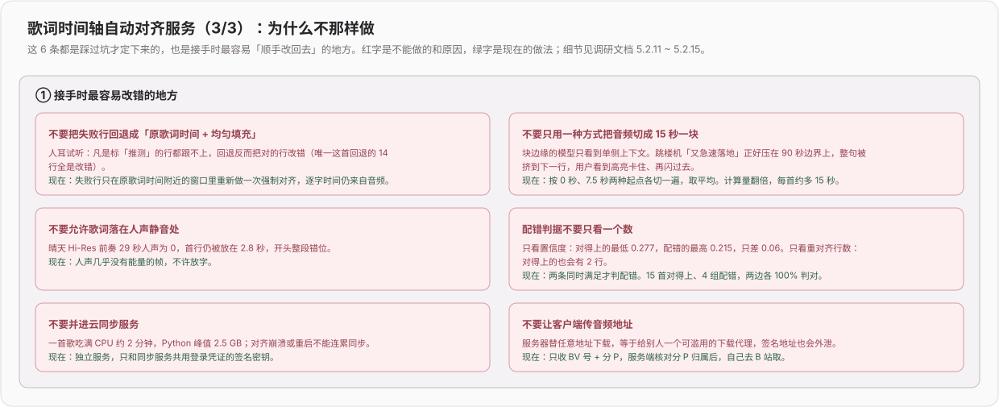

# 歌词时间轴对齐（2026）

> 专题开发日志。新记录在上；记录规则和总入口见 [`DEVLOG.md`](../../DEVLOG.md)。研究过程、失败尝试和设计取舍见 [`docs/ideas/002-歌词时间轴对齐.md`](../ideas/002-歌词时间轴对齐.md)，算法数据见 [`docs/lyrics/歌词时间轴对齐-可行方案调研.md`](../lyrics/歌词时间轴对齐-可行方案调研.md)。

## 2026-10-19 feat: 新增歌词时间轴自动对齐服务端

**效果**：常规投稿第一次对齐约 2 分钟，之后所有人打开都直接用。在 7 首有人工逐字时间的歌上，行起点中位误差 40 ms，网易云自己的逐行歌词是 194 ms。用户上传或纠错的歌词经审核员通过后，对这个投稿的所有人生效。本次只有服务端，客户端入口、预览、采用 / 还原在下一阶段做。

**数据流**：

- 客户端只发 BV 号、分 P 和歌词文本，登录沿用云同步换来的凭证。
- 服务端先清洗歌词、算指纹，命中「投稿 + 分 P + 指纹」缓存就直接返回。
- 没命中时，服务端自己向 B 站取音频（核对分 P 归属、只用非 PCDN、请求间隔 3 秒），交给 Python worker 分离人声、逐字强制对齐，再判断歌词是否配错，最后写入内存 + 磁盘缓存。
- 一次只跑一首，客户端每 3 秒轮询一次进度。

本机实测：跳楼机全程 106 秒（下载 3 秒，分离人声 + 对齐 100 秒），Python 峰值内存约 2.5 GB。用跳楼机的音频配白马的歌词，102 秒后返回「歌词和这首歌的音频对不上」。

**出错时**：每种失败一个错误码、一句能照着做的话，服务端和客户端都不自动重试。服务器自己的问题（B 站限流、只拿到 PCDN、下载失败、对齐崩溃）不扣用户当天的次数，歌词配错照扣。

**关键代码**：

- [`biu-align-server/`](../../biu-align-server/README.md)：独立服务，不并进云同步服务，只和它共用签名密钥。
- [`worker/align.py`](../../biu-align-server/worker/align.py)：人声分离 + 强制对齐，带静音门控、双切平均、局部重对齐。
- [`src/lib/queue.ts`](../../biu-align-server/src/lib/queue.ts)：单并发队列、每日配额、配错拦截。
- [`src/lib/submissions.ts`](../../biu-align-server/src/lib/submissions.ts)：提交与审核状态机。
- [`src/lib/errors.ts`](../../biu-align-server/src/lib/errors.ts)：错误码与文案。

**验证**：26 个单测覆盖歌词清洗、指纹、bvid / cid 校验、逐段切分、PCDN 判定与客户端一致、队列、配错判据和 HTTP 全流程，另做了真实 B 站 + 真实模型的端到端。单测抓到一个路由顺序 bug：`/lyrics/:bvid/:cid` 注册在 `/lyrics/submissions/mine` 前面，后者会被前者吃掉，已修。

## 2026-10-19 docs(lyrics): 歌词时间轴对齐定案为「分离人声 + MMS_FA 强制对齐」

**效果**：时间轴对齐方案调研完成并定案，取代此前自研的「Whisper 识别 + DTW + 平移」。在 7 首有网易云人工逐字时间的歌（327 行）上，行起点中位误差 40 ms，98% 的行在 300 ms 以内；逐字中位误差 26 ms，95% 在 150 ms 以内。用户另给的 3 首常规投稿，人耳确认都能跟上。

**文档**：调研全过程、各轮数据和人耳裁决写进 [`docs/lyrics/歌词时间轴对齐-可行方案调研.md`](../lyrics/歌词时间轴对齐-可行方案调研.md)（5.2 ~ 5.2.15），研究总账同步到 [`docs/ideas/002`](../ideas/002-歌词时间轴对齐.md)。删除已过时的旧方案文档：阿里云 ASR 版对齐规格、Demucs 进度显示、Python 改 TS 策略、听歌识曲自定义 Python 路径；纯中文歌测试指南含本机路径，移到私有运维目录。`001-Android-适配` 里指向旧规格的链接改指 002。

