# 歌词时间轴对齐（2026）

> 专题开发日志。新记录在上；记录规则和总入口见 [`DEVLOG.md`](../../DEVLOG.md)。研究过程、失败尝试和设计取舍见 [`docs/ideas/002-歌词时间轴对齐.md`](../ideas/002-歌词时间轴对齐.md)，算法数据见 [`docs/lyrics/歌词时间轴对齐-可行方案调研.md`](../lyrics/歌词时间轴对齐-可行方案调研.md)。

## 2026-10-22 feat(lyrics): 手动搜歌词可一键换关键词

**效果**：手动「搜索歌词」弹窗在输入框下多一行「试试：」，列出自动提取的其他歌名候选、UP 主名和完整视频标题，点一下就按它搜，自动提取的歌名选错时不用再退出去重命名查歌名

## 2026-10-22 fix(lyrics): 对齐失败标签不再因点「关闭」变回「未对齐」

**效果**：对齐失败的标签一直保留到重试成功或换了歌词；面板里只留下一步该做的操作（重试 / 换一份歌词 / 上传我的歌词），没有「关闭」按钮，点面板外即可收起。此前点「关闭」会让标签退回「未对齐 · 估算」并出现「登录后会自动对齐」的说法，同一件事前后说法不一

## 2026-10-21 feat(lyrics): 日语、英语、韩语歌词新增自动逐字对齐

**效果**：自动逐字对齐从只支持中文扩展到日语、英语、韩语。此前日语歌几乎都被判「歌词对不上」，韩语直接提示不支持，英语能出结果但约五分之一的行起点偏差超过 300 毫秒。现在英语改用专门在歌声上训练的开源模型（LyricsAlignment-MTL，MIT 许可），日语、韩语沿用中文那套对齐模型，先把歌词转成读音再对齐；中文的处理一处没动。其他语言提示改为「暂时只支持中文、日语、韩语和英语歌词，其他语言还在做」。人耳试听确认 Counting Stars、Faded、Blinding Lights、アイドル 新结果更准

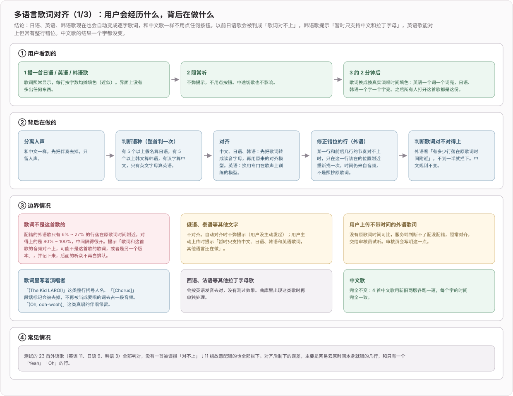

**实测（行起点与人工基准的偏差）**：

| 语种 | 样本 | 中位偏差 | 300 ms 内 | 错 1 秒以上 |
| --- | --- | --- | --- | --- |
| 英语 | 11 首 / 647 行 | 39 ms | 95% | 9 行 |
| 日语 | 9 首 / 483 行 | 47 ms | 95% | 1 行 |
| 韩语 | 3 首 / 174 行（样本不足） | 58 ms | 86% | 8 行 |
| 中文（线上，不变） | 327 行 | 27 ms | 99% | 1 行 |

改之前英语是 62 ms / 81% / 56 行；直接用网易云逐行时间是 95 ms / 81% / 20 行

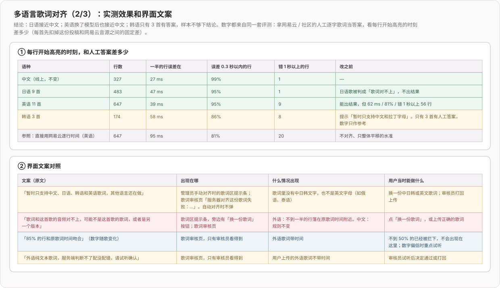

**数据流**：

- 服务端按歌词判语种分流：英语走歌声模型；日语先取每个词的读音再转成拉丁字母、韩语逐音节转写，再走原对齐模型；中文原样不变。结果额外记下语种、吻合度和每行原始时间
- 判「歌词对不上」：中文仍看置信度；外语看吻合度——对齐出的行起点有多少落在「原歌词时间 + 整首偏移」±1 秒内。23 首对得上的外语歌在 0.88~1.00，11 组故意配错的在 0.06~0.27，按 50% 划线全部判对
- 外语纯文本歌词（只会来自用户上传）没有原歌词时间可比，算不出吻合度，而置信度又分不开对错两组，所以不判，照常对齐后交给审核员试听确认；审核页会提示这一点
- 结果版本号加一，旧版本的对齐结果不会被当成新结果复用；歌词清洗补上日韩文作词作曲行、整行演唱者标注和 `[Chorus]` 这类段落标记

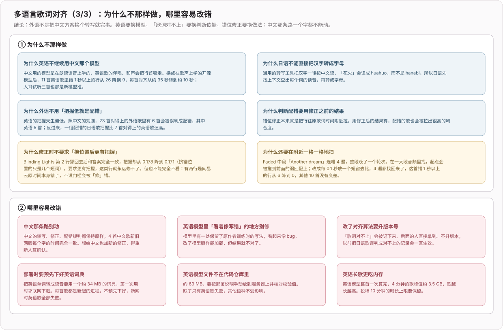

**关键代码**：

- [`biu-align-server/worker/align.py`](../../biu-align-server/worker/align.py)：按语种分流；[`romanize.py`](../../biu-align-server/worker/romanize.py)、[`singing.py`](../../biu-align-server/worker/singing.py)、[`repair.py`](../../biu-align-server/worker/repair.py)：转写、英语歌声模型、行起点修复。
- [`biu-align-server/src/lib/result.ts`](../../biu-align-server/src/lib/result.ts)：外语按吻合度判配错，修掉 "I've" 被拆成两段。
- [`src/components/lyrics-align-modal/review-tab.tsx`](../../src/components/lyrics-align-modal/review-tab.tsx)：审核页显示吻合度或纯文本提示。
- 数据和取舍见 [`docs/lyrics/歌词时间轴对齐-多语言方案调研.md`](../lyrics/歌词时间轴对齐-多语言方案调研.md)。

**部署注意**：

- 英语模型权重（69 MB）不进仓库，手动放到 `worker/models/checkpoint_MTL` 并核对 sha256 `826559e7…3c1`
- 用部署账号先跑一次 `venv/bin/python -c "import g2p_en; g2p_en.G2p()('hello')"`，预下载约 34 MB 的英语词典，否则首个英语任务会卡在下载
- 英语长歌内存峰值约 3.5 GB（4 分钟的歌）

**未验证**：未部署到 Mac mini，线上仍是旧版；没有起 Node 服务走真实 B 站接口的端到端测试；韩语只有 3 首样本

## 2026-10-20 feat(lyrics): 歌词区显示逐字对齐状态，没对齐的歌词填色跟回原歌词时间

**效果**：歌词区左上角常驻一个只读标签，听众能分清眼前的逐字填色是哪一种：灰点「未对齐 · 逐字按行匀速估算」、转圈「对齐中」（排队时带前面几首）、绿点「已对齐 · 逐字按演唱时间」。自动对齐不出提示条，此前看不出歌是还没对齐、正在对齐还是已经对齐好了。顶部对齐提示条露面时标签让开，没有歌词时不显示。

没对齐的歌词改回接入对齐前桌面歌词的口径：从本行时间匀速填到下一行开始，下一行开始时正好填满；最后一行沿用当时的 5 秒。撤回了上一版「每字最多 0.6 秒」的上限：它让后面接间奏的行提前填满、整行亮着干等，看起来和原歌词对不上。《不许你注定一人》的网易云歌词 38 行里有 19 行受影响，最长的一句行距 22.6 秒、8.4 秒就填满了；《背对背拥抱》开头的「制作人」一行 0:07 已全亮，下一行到 0:24 才开始。代价是长间奏前的那一句填得慢。对齐过的歌词按逐字时间填，不受这次改动影响。

**验证**：`tests/lyrics-align-status.test.tsx` 覆盖未对齐、已对齐、后台排队、提示条露面时让开、无歌词五种情况；`tests/lyrics-karaoke.test.ts` 改为锁定「填到下一行开始」和最后一行 5 秒。本地网页版连线上对齐服务看过「已对齐」「未对齐」两种标签，以及「制作人」一行在 0:08 只填到第 2 个字；「对齐中」需要登录，只有单测覆盖。

## 2026-10-20 feat(lyrics): 播放时自动逐字对齐，用户可以上传歌词或报错

**效果**：普通听众不用再点「对齐」。播到一首还没有逐字歌词的歌，听满 5 秒后服务器在后台排队对齐，期间不出提示条，好了歌词自己换成按真实演唱时间填色；第一份对齐成功的结果直接对所有人生效，之后谁打开都是逐字歌词。去掉了每个账号每天 20 次和排队 20 首的上限。用户侧只剩两个入口：「上传我的歌词」（带不带时间都行，进审核）和「报错：时间轴不对」（进管理员处理）；「重新对齐当前歌词」「换一份歌词再对齐」只有管理员看得到，插到队首、跳过已有结果重跑，用来判断是算法错了还是歌词 / 音频的问题。歌词审核页分「用户上传」「时间轴报错」两栏。同时修掉三处显示问题：逐字填色的重影、三处填色颜色不一致、桌面歌词拉大窗口字不变

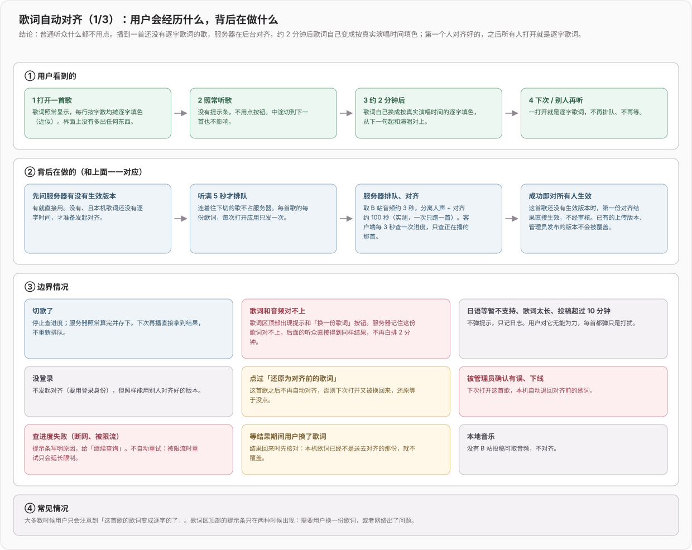

**数据流**：

- 打开一首歌：先查服务器上的生效版本，有就直接用；没有、且本机歌词还没有逐字时间，听满 5 秒后用当前歌词（自动匹配的或用户自己选的）发起对齐。每首歌的每份歌词，每次打开应用只发一次，失败不自动重试；只查正在播那首的进度，切歌即停，服务器照常算完存下，下次直接命中
- 服务端出队：管理员手动的最先；其余按账号轮流，每人先跑他最近点的那首，连切几十首的人只占自己那一份。对齐成功后，这首歌还没有生效版本就直接生效；已有的上传版本、管理员发布的版本不被覆盖
- 「歌词对不上」「歌词比音频长」「投稿太长」这类换谁来跑都一样的失败记下来，后面的听众直接拿到同样结果，不再白排 2 分钟；限流、下载失败等服务器侧原因不记。日语等暂不支持的语言、歌词太长时不弹提示，只记日志
- 报错「确认有误，下线」：撤掉这份生效版本，并记一笔，防止下一位听众自动对齐又把它顶回来；客户端下次打开这首歌发现生效版本没了，自动退回对齐前的歌词。用户点过「还原为对齐前的歌词」的歌不再自动对齐
- 等结果期间用户换了歌词，结果回来时发现本机歌词已不是送去对齐的那份，就不覆盖

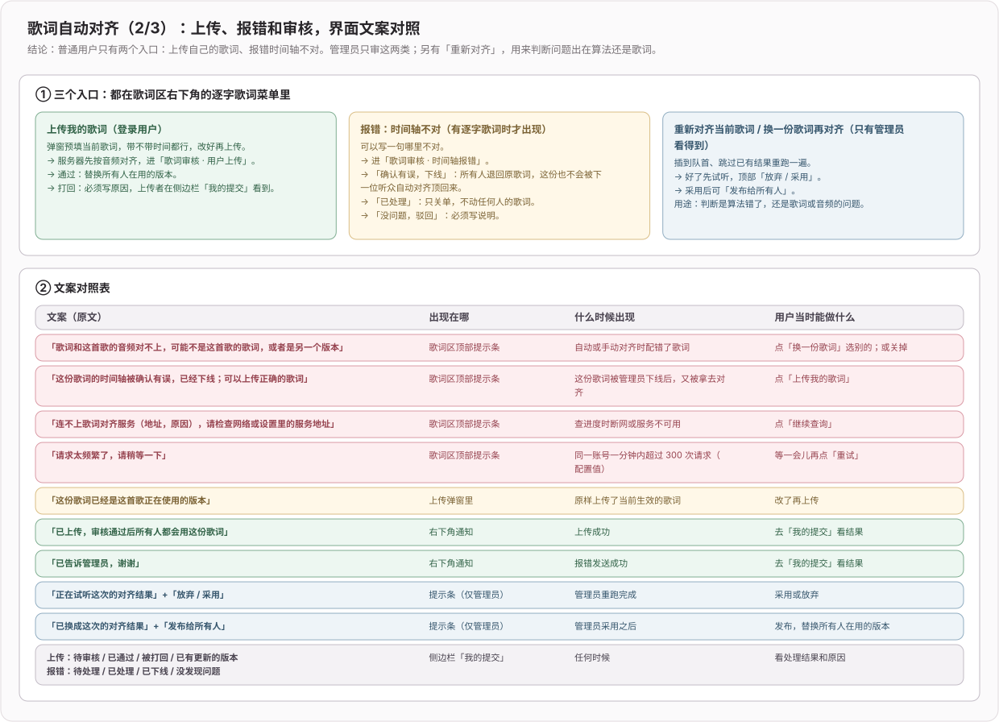

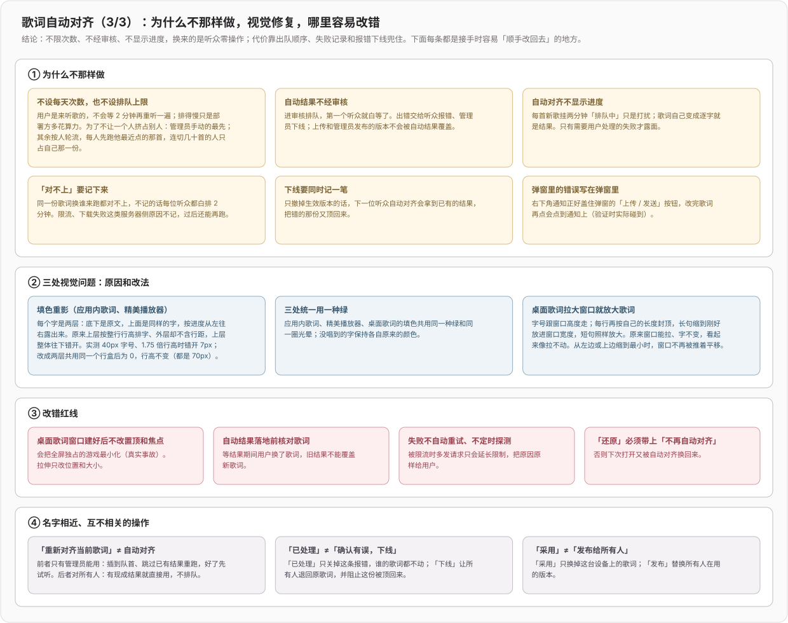

**显示问题的原因**：

- 重影：每个字是底层原文 + 上层同样的字按进度露出。外层是普通行内元素时，上层按行高排字、外层盒子却不含行距，上层整体往下错开；实测 40px 字号、1.75 倍行高时错开 7px，改成行内块后为 0，行高不变（都是 70px）。应用内歌词和精美播放器都是这个原因。
- 颜色：应用内歌词、精美播放器、桌面歌词的填色共用同一种绿和光晕，没唱到的字保持各自原来的颜色
- 桌面歌词：窗口一直能拉伸，但字号是固定值，拉大了字不变，看起来像拉不动。现在字号跟窗口高度走，每行再按自己的长度封顶，长句缩到刚好放进窗口宽度；从左边或上边缩到最小时窗口不再被推着平移。窗口创建后仍只改位置和大小，不碰置顶和焦点

**改动中顺手修掉的**：上传和报错弹窗的失败提示改为写在弹窗里，原来右下角的通知正好盖住「上传 / 发送」按钮；歌词区逐字歌词菜单改为从按钮向上展开，管理员的 5 项原来会伸出窗口底部被裁掉；三端转发层「请先登录」的文案去掉了已不存在的「每日次数」

**关键代码**：

- [`biu-align-server/src/lib/queue.ts`](../../biu-align-server/src/lib/queue.ts)：去掉次数和上限，出队顺序（管理员最先、按账号轮流）。
- [`biu-align-server/src/lib/reports.ts`](../../biu-align-server/src/lib/reports.ts)、[`biu-align-server/src/routes.ts`](../../biu-align-server/src/routes.ts)：报错、下线、管理员发布；[`alignment-cache.ts`](../../biu-align-server/src/lib/alignment-cache.ts) 里的失败记录。
- [`src/store/lyrics-align-session.ts`](../../src/store/lyrics-align-session.ts)：自动对齐与管理员手动重跑两种模式。
- [`src/components/lyrics/broadcaster.tsx`](../../src/components/lyrics/broadcaster.tsx)：打开一首歌时决定用哪份歌词、要不要发起自动对齐。
- [`src/components/lyrics-align-modal/review-tab.tsx`](../../src/components/lyrics-align-modal/review-tab.tsx)、[`report-modal.tsx`](../../src/components/lyrics-align-modal/report-modal.tsx)：审核页两栏和报错弹窗。
- [`src/components/lyrics/karaoke-text.tsx`](../../src/components/lyrics/karaoke-text.tsx)、[`src/pages/desktop-lyrics/index.tsx`](../../src/pages/desktop-lyrics/index.tsx)：重影修复、桌面歌词字号。

**未验证**：新版服务端尚未部署到 Mac mini，线上仍是旧版（审核页会提示无法识别的内容）；手机和网页版只更新了转发白名单，没有实机走过新接口

## 2026-10-20 feat(lyrics): 所有歌词逐字填色，歌词区一键对齐、边听边试

**效果**：所有歌词当前行都会逐字填色，不再只有对齐过的歌才有。对齐过的按真实逐字时间填，网易云 / LrcLib / 自动匹配的歌词按行内字数均摊，每字最多 0.6 秒。全屏播放器、精美播放器、手机布局、桌面歌词、歌词审核页用同一套填色和时间计算；桌面歌词从整行匀速填色改成逐字。对齐改成在歌词区点一下就开始，期间照常听歌，好了直接在歌词和桌面歌词里试听，满意再采用、再决定要不要提交审核。「我的提交」「歌词审核」两页和全部提示文案改成项目原有的列表样式和产品用语。

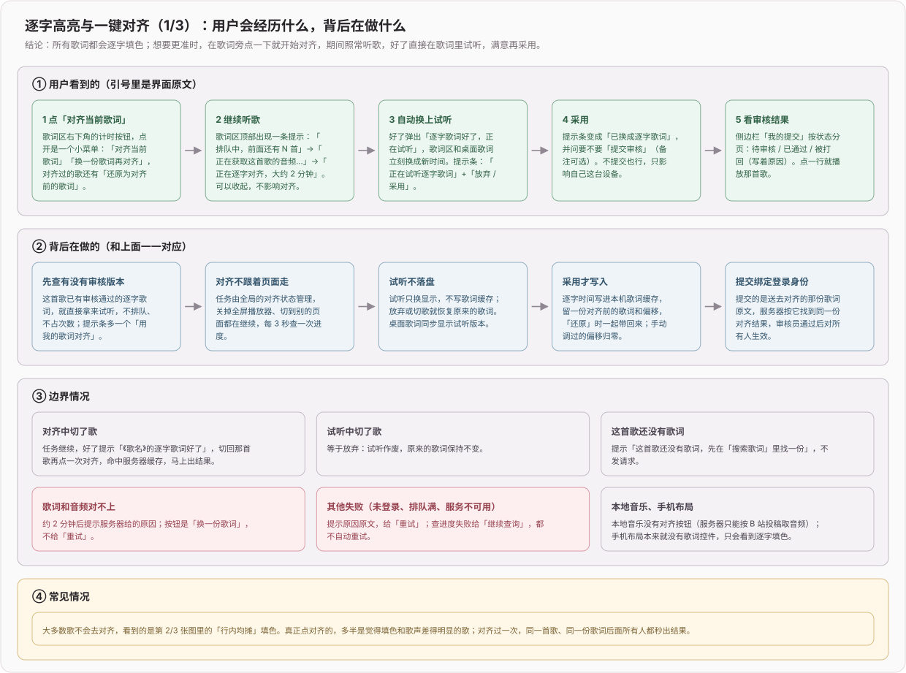

**数据流**：

- 歌词区计时按钮点开是小菜单：「对齐当前歌词」「换一份歌词再对齐」，对齐过的歌还有「还原为对齐前的歌词」。原来的对齐弹窗只剩「换一份歌词」时的编辑框。
- 对齐任务由全局的对齐状态管理，关掉全屏播放器、切页面、切歌都不中断；进度、试听、采用、提交都显示在歌词区顶部的提示条里。开始前先查有没有审核通过的版本，有就直接试听，不排队也不占次数。
- 试听只换显示（歌词区 + 桌面歌词），不写歌词缓存；放弃或切歌就回到原来的歌词。采用才写入缓存，同时把手动调过的偏移归零，旧偏移和对齐前的歌词一起留着，「还原」时一并带回。
- 桌面歌词窗按主窗口最后一次同步的进度自己往后推算；主窗口每次进度更新时核对一次，差出 0.3 秒以上（拖动进度条、卡顿）就补发校准。

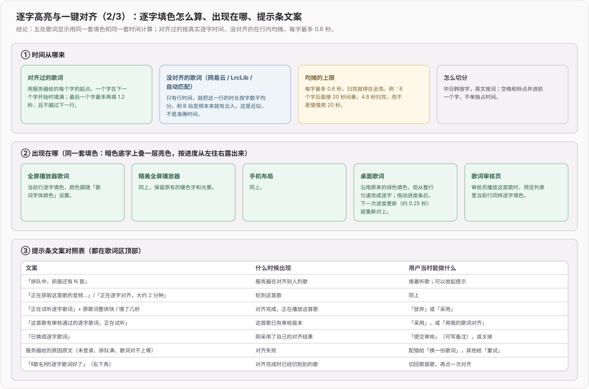

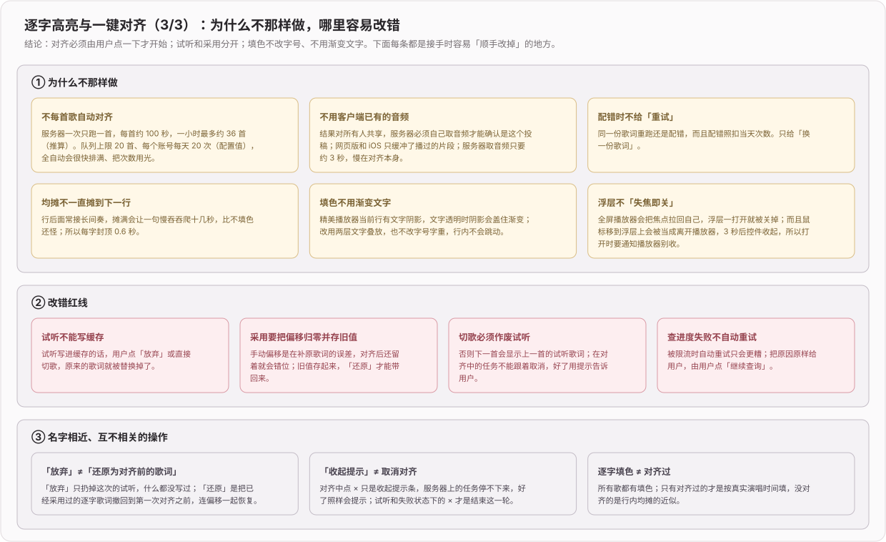

**改动中顺手修掉的**：全屏播放器里，歌词控件（字号、偏移、对齐）的浮层渲染在播放器外层，鼠标移上去会被当成离开播放器，3 秒后控件连浮层一起收起；现在浮层开着时通知播放器不收起，和设置浮层同样处理。

**关键代码**：

- [`src/components/lyrics/karaoke.ts`](../../src/components/lyrics/karaoke.ts)：切分单元、均摊和逐字进度，五处显示共用。
- [`src/components/lyrics/karaoke-text.tsx`](../../src/components/lyrics/karaoke-text.tsx)：两层文字叠放的逐字填色。
- [`src/store/lyrics-align-session.ts`](../../src/store/lyrics-align-session.ts)：对齐、轮询、试听、采用、提交的全局状态。
- [`src/components/lyrics/align-bar.tsx`](../../src/components/lyrics/align-bar.tsx)：歌词区顶部提示条。

**验证**：新增 `tests/lyrics-karaoke.test.ts`（切分、均摊、0.6 秒上限、对齐过的逐字进度），采用 / 还原的单测补上偏移归零和恢复。桌面开发版 + 线上服务实测：网易云歌词均摊填色（中文、日文）；跳楼机命中缓存约 1 秒进入试听，采用后提示提交审核；一首日文歌真实排队约 100 秒后提示歌词对不上；桌面歌词逐字填色；全屏、手机布局、歌词审核页和「我的提交」页显示正常。网页版本地开发验证了菜单、无歌词提示和失败提示；本地没有对齐服务和 B 站登录，试听、采用只在桌面版验证过。

## 2026-10-20 feat(lyrics): 侧边栏新增「我的提交」和「歌词审核」

**效果**：提交过歌词的人在侧边栏「我的提交」里一次看到所有提交和审核结果（待审核 / 已通过 / 被打回附原因 / 已被新版本替换），不用记自己交过哪首。审核员多一个「歌词审核」入口，右侧红色数字是待审数量，逐条通过或写原因打回。两个入口都进了「设置 → 菜单设置」，能像其他菜单一样隐藏；「歌词审核」和它的开关只有审核员账号看得到。对齐弹窗去掉「我的提交」「审核」两个标签页，只留对齐本身。至此歌词逐字对齐的客户端完整可用。

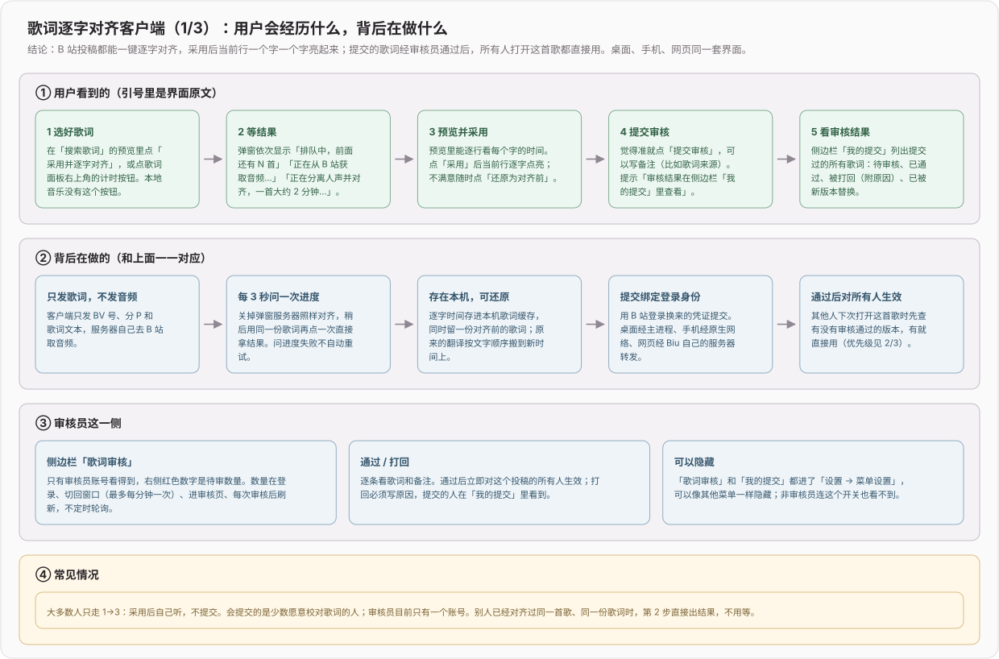

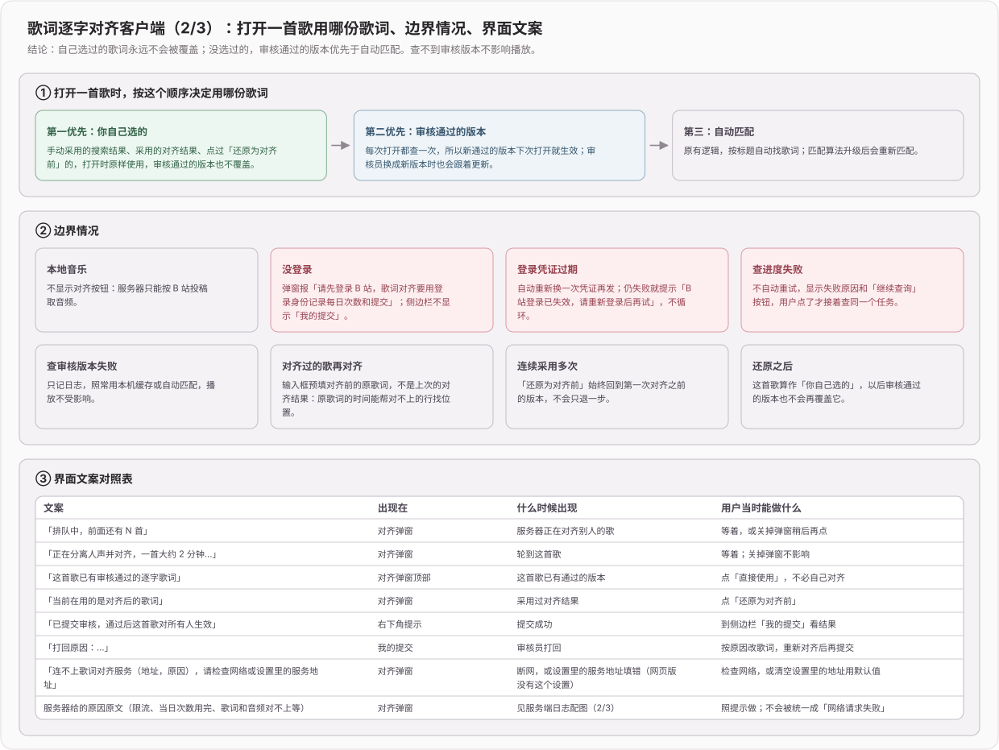

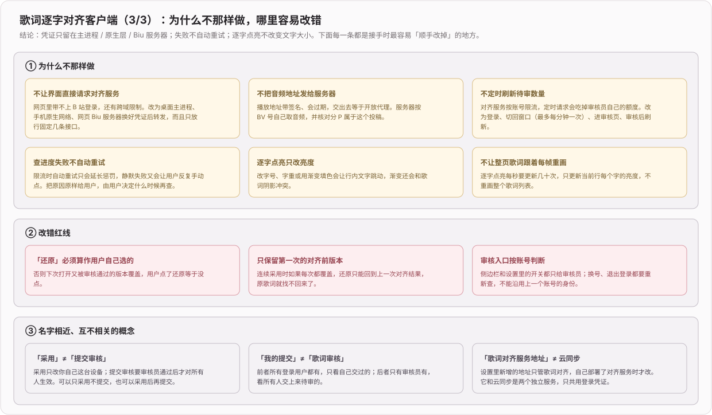

**关键决策**：

- 审核员身份由对齐服务按登录账号判定，登录、换号、退出时重新查。
- 待审数量只在登录、窗口切回前台（最多每分钟一次）、进审核页、每次审核后刷新，不定时轮询：对齐服务按账号限流，轮询会吃掉审核员自己的额度。
- 侧边栏菜单项新增可选的计数角标：展开态显示在右侧，折叠态挂在图标上，不靠悬停才能看到。

**验证**：桌面开发版 + 线上服务实测：侧边栏角标 → 审核页 → 打回，提交者在「我的提交」看到打回原因；设置里取消勾选「我的提交」后侧边栏立即隐藏，重新勾选恢复。

## 2026-10-20 feat(lyrics): 歌词逐字对齐弹窗，采用后当前行逐字点亮

**效果**：B 站投稿可以从两处进入逐字对齐：「搜索歌词」预览里的「采用并逐字对齐」，或歌词面板右上角的计时按钮。弹窗显示排队位置和进度，结果可预览、采用、提交审核；采用后当前行一个字一个字亮起来，随时能「还原为对齐前」。打开一首歌时，审核通过的版本优先于自动匹配，但不覆盖用户自己选过的歌词。桌面和手机的设置里新增「歌词对齐服务地址」，自部署时才需要改。

**数据流**：

- 采用的结果写进本机歌词缓存：逐字时间一份，行级歌词一份（给桌面歌词等只认行时间的地方用），第一次采用前的原歌词留作还原；原来的翻译按文字顺序搬到对齐后的时间上。
- 打开歌曲时先读本机缓存；不是用户自己选的，就再查一次审核通过的版本，有新版本就替换。查不到只记日志，照常用缓存或自动匹配。
- 逐字点亮每帧只更新当前行每个字的亮度，不重画整个歌词列表，也不改字号字重，避免行内文字跳动。

**验证**：`tests/lyrics-align.test.ts` 覆盖接口白名单与服务地址兜底、采用后保留原歌词并搬移翻译、哪些来源可被审核版本替换、切行时刻。实机（桌面开发版 + 线上服务）：跳楼机对齐、预览、采用，逐字时间人耳确认无错行。

## 2026-10-20 feat(lyrics): 客户端接入歌词对齐服务，三端都由持有登录的一侧转发

**效果**：桌面、Android / iOS、网页都能调用对齐服务。界面层只说「要做什么」，不碰凭证：桌面经主进程、手机经原生网络、网页经 Biu 服务器，各自用 B 站登录换对齐服务的凭证再转发。失败时把服务端给的原因原样带回界面，不统一成「网络请求失败」。

**关键决策**：

- 只放行对齐服务的固定几条接口（发起对齐、查进度、查审核版本、提交、我的提交、审核），白名单之外一律不发，免得界面层借转发把凭证带去别的地址。查审核版本不需要登录。
- 凭证过期时重新换一次再发，仍失败就交给用户，不循环；连不上时报出服务地址和原因，提示检查网络或设置里的服务地址。
- 服务地址读应用设置，留空用默认公网地址；远程地址只接受 HTTPS，明文 HTTP 只允许本机（mock 开发）。
- 网页版转发和云同步转发共用凭证缓存；对齐服务和网页服务在同一台机器上，走本机端口。

**验证**：`tests/web-align-proxy.test.ts` 覆盖网页转发：带服务端凭证转发并原样透传错误、凭证过期只重换一次、未登录可查审核版本、白名单外路径拒绝。

## 2026-10-19 fix(lyrics): 对齐结果不再带出提交者的 B 站 UID

**效果**：对齐结果里只留歌词时间轴需要的字段。此前生成结果时把整个任务对象展开写了进去，提交者 UID、任务 id、内部状态会随缓存一起保存，并经「审核通过的歌词」公开接口和缓存命中返回给任何人。

**影响范围**：发现时线上缓存只有 1 条（部署联调时的测试数据，里面是审核员自己的 UID），部署修复版本时一并删除。

**验证**：HTTP 测试锁定公开结果的字段集合，旧代码下这条测试失败（多出 `mid` 等 5 个字段），修复后通过。

## 2026-10-19 feat(lyrics): 对齐服务支持 mock 模式和测试 token，本地开发不需要 Python

**效果**：只改接口、审核流程或客户端界面的开发者，不用装 Python 和 1.3 GB 模型，也不用访问 B 站：`pnpm dev:mock` 几秒后返回假时间轴，`pnpm token <mid>` 签一个本地测试 token。README 新增「三种开发方式」，按要改的东西选：mock、完整本地、连已部署的服务。

**关键决策**：

- mock 只替换「取音频 + 对齐」两步，队列、配额、轮询、提交、审核都走真实代码，在 mock 下调通的流程，换成真实模式不用改。
- mock 结果写进单独的缓存目录，切回真实模式时不会被当成真结果返回。
- `NODE_ENV=production` 下，mock 模式和签 token 都拒绝执行：前者会把假时间轴经审核共享给所有人，后者在生产机上签出的是能冒充任意用户的真凭证。
- 开关用命令行 `--mock`：npm script 里写 `VAR=x` 前缀，在 Windows cmd 下不生效。

## 2026-10-19 build: 对齐服务部署到 Mac mini，服务器上不用装 ffmpeg

**效果**：对齐服务已上线，公网入口 `https://biu.alcmaple.cn/align/`。它和云同步共用域名与证书，经新的反向隧道转到 Mac mini，原有的同步、Web 服务都没有重启或改动。线上实测：跳楼机全程 91 秒，结果和人耳确认过的版本逐行一致；提交审核、审核员打回、同一份歌词再次提交命中缓存都正常。

**改动**：

- worker 先把音频转成 wav 再分离人声：有 ffmpeg 就用 ffmpeg，没有就用 macOS 自带的 afconvert。Mac mini 没装 ffmpeg，afconvert 能直接读 B 站 DASH 音频，所以不用为此装一整套 ffmpeg 依赖。
- Python 依赖版本锁进 `worker/requirements.txt`，和算法数据测出时的版本一致。
- launchd 用 `Standard` 加 `Nice 5`，不用 `Background`：后者会被系统大幅限 CPU，任务明显变慢。

**验证**：在开发机去掉 ffmpeg 后跑通 afconvert 路径，结果与 ffmpeg 路径一致；Mac mini 上用 launchd 的最小 PATH 跑 worker，100 秒、峰值 2.8 GB；公网端到端见上。

## 2026-10-19 feat: 新增歌词时间轴自动对齐服务端

**效果**：常规投稿第一次对齐约 2 分钟，之后所有人打开都直接用。在 7 首有人工逐字时间的歌上，行起点中位误差 40 ms，网易云自己的逐行歌词是 194 ms。用户上传或纠错的歌词经审核员通过后，对这个投稿的所有人生效。本次只有服务端，客户端入口、预览、采用 / 还原在下一阶段做。

**数据流**：

- 客户端只发 BV 号、分 P 和歌词文本，登录沿用云同步换来的凭证。
- 服务端先清洗歌词、算指纹，命中「投稿 + 分 P + 指纹」缓存就直接返回。
- 没命中时，服务端自己向 B 站取音频（核对分 P 归属、只用非 PCDN、请求间隔 3 秒），交给 Python worker 分离人声、逐字强制对齐，再判断歌词是否配错，最后写入内存 + 磁盘缓存。
- 一次只跑一首，客户端每 3 秒轮询一次进度。

本机实测：跳楼机全程 106 秒（下载 3 秒，分离人声 + 对齐 100 秒），Python 峰值内存约 2.5 GB。用跳楼机的音频配白马的歌词，102 秒后返回「歌词和这首歌的音频对不上」。

**出错时**：每种失败一个错误码、一句能照着做的话，服务端和客户端都不自动重试。服务器自己的问题（B 站限流、只拿到 PCDN、下载失败、对齐崩溃）不扣用户当天的次数，歌词配错照扣。

**关键代码**：

- [`biu-align-server/`](../../biu-align-server/README.md)：独立服务，不并进云同步服务，只和它共用签名密钥。
- [`worker/align.py`](../../biu-align-server/worker/align.py)：人声分离 + 强制对齐，带静音门控、双切平均、局部重对齐。
- [`src/lib/queue.ts`](../../biu-align-server/src/lib/queue.ts)：单并发队列、每日配额、配错拦截。
- [`src/lib/submissions.ts`](../../biu-align-server/src/lib/submissions.ts)：提交与审核状态机。
- [`src/lib/errors.ts`](../../biu-align-server/src/lib/errors.ts)：错误码与文案。

**验证**：26 个单测覆盖歌词清洗、指纹、bvid / cid 校验、逐段切分、PCDN 判定与客户端一致、队列、配错判据和 HTTP 全流程，另做了真实 B 站 + 真实模型的端到端。单测抓到一个路由顺序 bug：`/lyrics/:bvid/:cid` 注册在 `/lyrics/submissions/mine` 前面，后者会被前者吃掉，已修。

## 2026-10-19 docs(lyrics): 歌词时间轴对齐定案为「分离人声 + MMS_FA 强制对齐」

**效果**：时间轴对齐方案调研完成并定案，取代此前自研的「Whisper 识别 + DTW + 平移」。在 7 首有网易云人工逐字时间的歌（327 行）上，行起点中位误差 40 ms，98% 的行在 300 ms 以内；逐字中位误差 26 ms，95% 在 150 ms 以内。用户另给的 3 首常规投稿，人耳确认都能跟上。

**文档**：调研全过程、各轮数据和人耳裁决写进 [`docs/lyrics/歌词时间轴对齐-可行方案调研.md`](../lyrics/歌词时间轴对齐-可行方案调研.md)（5.2 ~ 5.2.15），研究总账同步到 [`docs/ideas/002`](../ideas/002-歌词时间轴对齐.md)。删除已过时的旧方案文档：阿里云 ASR 版对齐规格、Demucs 进度显示、Python 改 TS 策略、听歌识曲自定义 Python 路径；纯中文歌测试指南含本机路径，移到私有运维目录。`001-Android-适配` 里指向旧规格的链接改指 002。
