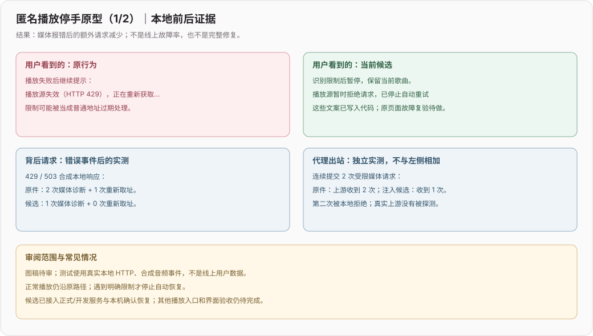
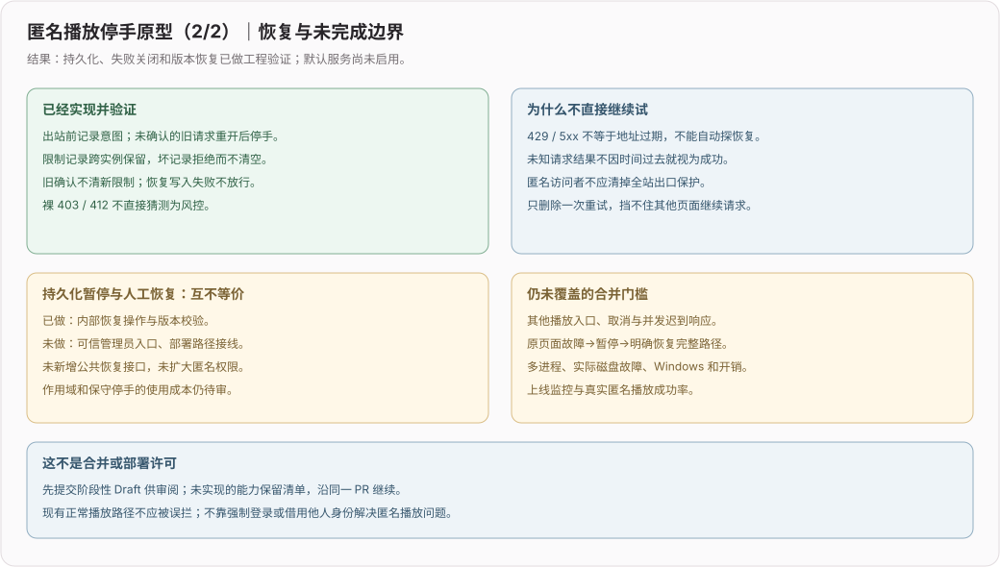
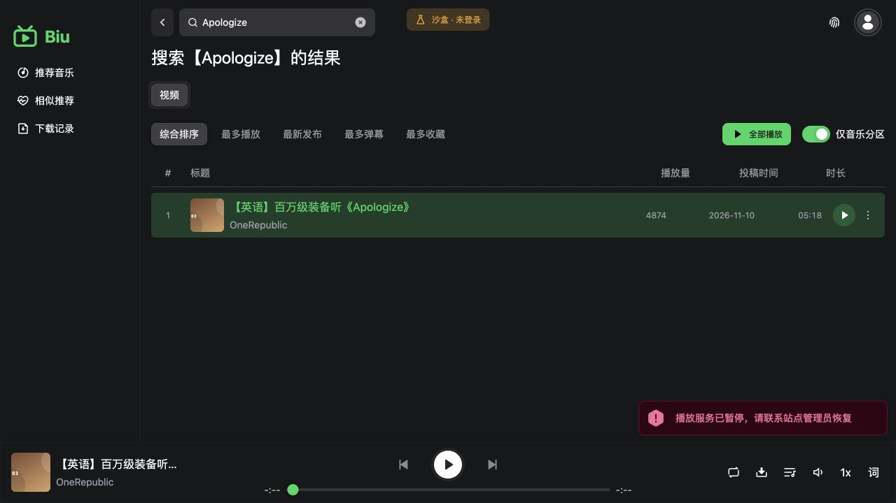
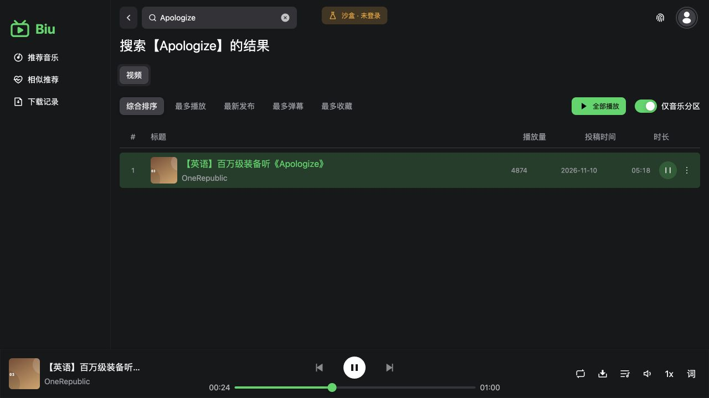

# 匿名播放停手原型（阶段性 Draft，待审）

**阶段3已接通媒体与三个取址入口的共享停手，覆盖NotSupportedError、取址和预取的暂停传播，并完成一次原React匿名503→暂停→明确恢复→播放的本地旅程。** 没有部署；真实上游、跨进程/平台/性能和更广泛故障组合仍待验收，保持Draft。




## 用户问题和证据

目标：匿名用户和宣传链接接收者遇到上游限制时，应用不通过诊断、取址或连跳歌曲继续放大请求。登录不是解决播放可靠性的默认前置条件。

共享基线395960的实际播放store遇到合成429/503后，追加2次媒体Range诊断和1次重新取址。实际匿名媒体代理对连续两次受限Range仍发送2次上游请求。请求只发往loopback，没有探测真实受限服务；Audio为jsdom替身，取址函数为请求本地HTTP的边界替身，不是线上事故数量或真实音频解码验收。

## 已实现的阶段

- `src/store/play-list.ts`：移除独立的64KiB日志探测；error链路共用一次1字节诊断，watchdog把已有诊断传给自救逻辑。429/5xx、423暂停响应或明确挑战头时保留当前曲并暂停，不沿该故障路径继续取址、换源和自动跳歌。
- `web-server/media-safety-store.ts`：严格版本记录、先保存出站意图、原子替换/fsync、锁冲突拒绝；限制和未确认请求跨实例保留。内部恢复需要最新revision，旧确认不覆盖新暂停，迟到限制仍生效。坏记录不清空；写失败不返回发送许可。
- `web-server/media-proxy.ts` / `proxy-common.ts`：可显式注入账本，每个请求及重定向跳使用独立观察器；先记录状态再返回本地423。后续受限请求不触达上游。没有新增公开恢复接口。
- 裸403/412与404、416、普通网络失败不直接猜成风控；代理仅识别明确挑战头。更多风控响应结构仍待覆盖。


## 阶段2：服务接线与本机恢复（2026-11-12）

正式Web服务默认使用运行账户目录下`.biu-web/media-safety.json`，与发布目录分开；开发服务按工作区路径哈希使用独立目录。`BIU_WEB_MEDIA_SAFETY_FILE`可指定绝对路径，空值和`memory`不会静默禁用保护。整个部署的媒体请求共享这份账本；不自动扩大到歌词/同步或所有B站API。

账本只在实际媒体发送时初始化。损坏文件或不可写目录只导致媒体返回423，不应拖垮静态页和健康检查。状态查询不创建缺失账本，也不列出在途请求ID或凭据。

先执行官方Web构建，再用同一服务账户和同一账本路径操作：

```sh
pnpm run build:web
pnpm run media:safety status --file /path/to/media-safety.json
pnpm run media:safety resume --file /path/to/media-safety.json --revision 12 --confirm resume-media
```

`12`只是示例，必须使用刚刚查询的当前版本。省略`--file`使用生产默认路径；开发模式加`--dev`并在对应工作区运行。发布包只有`dist/`时可运行`node dist/server/web-server/media-safety-cli.js`配合同样参数，不依赖tsx或下载运行时包。

- 普通暂停：本机明确恢复后，运行中的媒体服务下一次读取新版本即可继续；恢复本身不发网络探测。
- 存储/初始化失败：先排查原因，恢复可信记录/权限，明确恢复后**重启对应服务**；运行中失败锁存不会因文件自行变化就放行。
- 损坏记录、残留锁不自动清空或抢占。先确认没有活跃写入进程，再由运维处置；缺少可信记录时单独判断，不用空记录替代真实状态。
- 匿名来访者没有恢复全站的权限；没有新增HTTP管理接口、登录凭据或远程执行入口。

新增12项（配置/命令8，正式与开发各两种配置入口4），相关11文件120项通过。实际入口：首次429出站1次，重复请求仍为1；明确恢复且上游返回206后共2次；再破坏账本仍为2，健康检查200。只替换外部上游目的地和匿名身份边界，没有替换实际代理/账本/应用入口。

官方构建后的命令验证：status显示暂停版本12；旧版本11恢复退出1且拒绝；当前版本12明确确认后返回版本13、暂停解除。以上仅隔离文件，不是生产运维操作。

本轮正常UI基线：原整理者改名收藏与13秒保留，实际播放后暂停刷新12秒；独立新用户搜索续集、试听、本地保存找回、刷新50秒。使用60秒合成音频，不断言跨调用连续秒差；这不是错误恢复UI验收。


## 阶段3：取址与媒体共享停止，原页面复验（2026-11-12）

保护范围增加到现有三个取址路径：`/x/player/playurl`、`/x/player/wbi/playurl`、`/audio/music-service-c/url`，包含等价编码/斜杠形式。不把暂停扩大到搜索、普通稿件元数据或登录等其他接口；它们不是本阶段的全站保护承诺。

- 出站前持久化意图，取址429/5xx、明确挑战头、已有协议中的-352/-412及非空v_voucher会暂停。已持有的媒体token也不应绕过暂停。
- HTTP200非JSON、非对象或缺少有效整数code的响应保留未确认意图；当前实例撤销存活标记，重建后仍停。人工确认后迟到的未知结果也重新留痕，旧确认不会吞掉新不确定性。
- 普通HTTP403/404/412的合法JSON错误不直接猜风控。实际取消或无响应断连不保留伪造的惩罚记录；异常形状与取消分开。
- 客户端只识别HTTP423且code明确为BIU_MEDIA_PAUSED的错误，不按任意“423”文字判断。DASH工具不再吞掉该错误返回空地址，因而不会走失效删除/查稿件流程；NotSupportedError刷新收到暂停后停止，不制造未处理拒绝；旧曲迟到错误不暂停新曲。预取失败保留当前已缓冲播放，同一对歌曲不周期重试。
- 浏览器请求前的辅助签名、元数据和真实账号流程没有全部纳入这个scope；不宣称所有B站请求均被覆盖。

实际API边界的11个相同输入，原件8失败/3对照通过，候选通过；另增加普通取消/断连2项。8种受限/未知结果场景中，初始成功取址+一次受限取址共2次，随后三个取址入口、等价路径和媒体追加0次；普通元数据仍可读取，明确恢复后取址增加1次。

### 原页面的匿名恢复旅程

使用同一React页面和播放状态机、真实Axios fetch、实际BFF取址/媒体代理、实际文件账本和编译CLI。只替换目录、未登录身份及外部请求目的地，媒体是本地60秒合成AAC，**不是截图所列第三方歌曲音源**。

1. 从可见沙盒菜单选“未登录”，搜索Apologize并点播放。
2. 本地媒体503；再次点播放显示“播放服务已暂停，请联系站点管理员恢复”，歌曲仍在。
3. 刷新再点播放，本地上游依旧只有1次取址+1次503媒体。未调用真实受限服务。
4. 在隔离文件上运行当前revision4的本机确认恢复命令，变为5；确认命令本身新增网络请求0次。
5. 再点播放，同一歌曲进度真实推进至24秒后暂停25秒；新增1次取址和1次206媒体请求。




临时请求适配/开发中间件只在本地验证时桥接到实际BFF，验证后精确还原，不进入正式产物。新测试是一次性故障会话，不冒充稳定角色历史；本轮未重置任何长期角色。

## 两层实测不能相加或当完整上线结果

| 独立实验 | 原件 | 候选 |
| --- | --- | --- |
| store注入媒体error，状态429/503 | 2诊断 + 1取址 | 1诊断 + 0取址 |
| 向已注入账本的真实代理提交2次受限Range | 2次上游请求 | 1次上游请求 |

store诊断是否触达真实上游，取决于出站账本是否接入。本轮实际正式/开发入口在隔离HTTP上验证了接线；仍不能据此宣称真实生产“零追加请求”或全播放入口完成。

34项新增：21账本、6代理HTTP、7播放store；连同既有播放列表、token/代理核心和限速回归，共91项通过。隔离修改包重建后91项通过；4种拆守卫明确变红：忽略暂停、不写入状态、忽略恢复版本、忽略代理限制响应。

全量类型基线/候选都是206条相同既有诊断（行号移动单独归一化）、退出2；服务端类型与定向lint通过。正式`pnpm run build:web`通过。图稿XML合法，普通字体/宋体渲染共94项文字边界无溢出，图稿仍待审。

### 可执行的定向验证

```sh
pnpm run test --run tests/media-safety-store.test.ts tests/anonymous-media-safety.test.ts tests/anonymous-playback-stop.test.ts tests/play-list.test.ts tests/web-proxy-core.test.ts tests/web-media-pacer.test.ts
pnpm run build:web
```

仅运行以上测试会创建隔离临时账本和本地HTTP服务，结束后关闭/清理。不是让维护者访问真实B站或解除人工hold。

## 必须完成后再讨论合并

- [x] 正式/开发服务接线与路径隔离；坏账本关闭媒体，静态页/健康检查仍可用（隔离HTTP验证）。共享出口scope的产品取舍仍待审。
- [x] 本机管理员命令已实现并用编译产物验证；需当前revision和明确确认，不新增公共HTTP恢复入口或权限。
- [x] 本轮接入三个取址API，覆盖NotSupportedError、预取和暂停传播；未知响应、普通取消和旧曲迟到错误已有定向回归，更广泛并发仍待验。
- [x] 原React匿名503→暂停→刷新仍停→本机确认恢复→播放已在隔离HTTP复验；下方有实际截图，不等于线上/实机验收。
- [ ] 验证跨进程、锁残留、真实写失败/断电、目录fsync平台兼容性与写入开销。
- [ ] 验证正常播放、404地址更新、Range/206/416、账号隔离和取消没有退化。
- [ ] 补实机/线上匿名播放指标；模拟通过不等于上游内容、音质或网络验收。

## 待审取舍、替代方案和成本

- 候选倾向同一部署的媒体出口共享停手。好处是一个匿名用户不能靠新会话继续打受限出口；代价是局部CDN故障可能影响其他访客，最终scope需审阅，不默认扩大到全部B站API。
- 仅对当前歌曲内存暂停更轻，但刷新/其他标签可继续请求；仅删除诊断也挡不住媒体加载器本身。这两项均不是持久化停手替代。
- 同步文件写入和fsync可先清楚验证失败关闭；实际并发开销未量化，可能需改异步实现。每份账本最多128个在途记录是防止无限膨胀的实现上限，不是测出的部署容量。
- 不自动回收残留锁或定时探恢复，避免把时间过去当作安全恢复证据。运维处理流程必须与可信恢复入口一起交付。
- 本阶段不新加依赖、不改变登录权限、不迁移收藏/用户数据、不启用真实采集。媒体缓存、功能漏斗是独立后续机会，不混入此PR。

## 回退

本阶段修改限定播放错误分支和可注入的媒体保护模块。维护者决定撤回时在独立审核分支revert该PR提交并重新验证；不删除用户收藏或已有暂停文件。提交前已对7文件工程原型执行反向补丁和正向重建逐文件哈希校验；图稿和文档随本PR一起可逆撤回。
