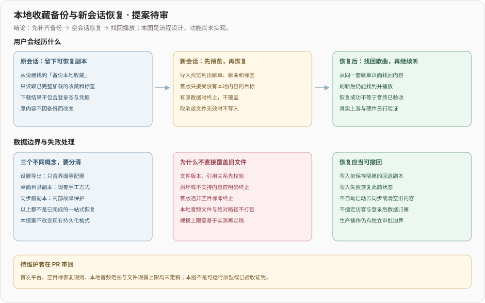

# 本地收藏备份与新会话恢复（方案待审，尚未实现）

## 结论与实际用户目标

建议补齐「备份现有收藏 → 新会话恢复 → 找回歌曲并播放」的完整任务，先评审范围和数据边界，再实施共享页面与平台适配。本文是流程方案，**不是可运行原型、功能交付或上线证明**；本轮没有导出收藏文件，也没有执行任何导入。

## 证据与三个不同概念

本轮 AI 模拟回访访客仍有一首 Apologize；在本地歌单的「收藏夹操作」以及设置底部没有找到备份或恢复入口。独立全新普通用户也检查了设置，结果相同。两段都是沙箱观察，不是两条真人生产反馈；没有由此推断数据丢失或原生桌面没有备份能力。

| 现有能力 | 当前依据 | 不应混淆的边界 |
| --- | --- | --- |
| 桌面文件副本 | [现有备份说明](../sync/local-favorites-backup.md)：退出应用后复制文档目录内两个 JSON 文件 | 是手工文件流程，不是 Web 页面的备份/恢复入口；不含音频文件 |
| 设置导出/导入 | `src/pages/settings/export-import.tsx` 仅处理 AppSettings；当前放在 `system-settings.tsx` 的非 Web 区块 | 设置文件不含本地歌单和歌曲，仅移动按钮并不等于可恢复收藏 |
| 同步前滚动副本 | `src/service/sync/backup.ts` 按账号及 store 保留设备本地快照 | 是内部故障保护，不是用户可下载、可预览的一站式恢复功能 |

观察环境含待审 PR #4 的访客导航；以上设置与备份相关源码和最新共享 master 相同。本文从最新共享 master 独立建分支，不依赖 #4。生产与原生设备尚未进行本轮验收。

## 已吸收维护者本轮新增的分享能力

编写期间共享 master 前移到 `d5089f71`，新增了在线收藏夹/本地歌单的分享与直接播放，以及私密收藏夹限制。已用 App 重新 fetch，并只在 AI 独立分支 fast-forward 吸收；维护者原工作区保持原样，未覆盖其日志。设置、配置导出、滚动备份及手工备份文档与观察基线逐字节一致。

如果实际需求只是「在另一会话继续听」，新分享能力是已有候选，不应再造同款入口。本文仅讨论**可下载的本地收藏/组织与标签副本，以及不依赖分享链接的新会话恢复**；分享播放与本地备份不画等号。新分享功能本轮未做界面、服务或线上验收，也未生成/发布分享链接。

维护者随后在 `de146b85` 修正本地歌单分享的负数 ID，并更新了触发提交扫描的测试路径样本。本方案已再次以新 master 为基线；本地曾准备的夹具修复已被该提交覆盖，未另提重复修复 PR，也不把它作为本方案依赖。

## 推荐的第一阶段（仍待维护者批准）

- 建议先做 Web 与沙箱的端到端实现；Electron 等平台继续现有方式，接入同一格式前单列实机验收，不声称已全平台支持。
- 沿用同一 React 设置页和本地歌单页，不另造访客页面；控件名直接区分「备份本地收藏」「恢复本地收藏」与「导出配置」。
- 首期对象为在线资源的本地歌单、条目及标签。账号、Cookie、凭据、同步基线、滚动副本、设置、播放地址、音频文件不放进备份。
- 首期仅恢复到空目标：没有歌曲、自建本地歌单或自定义标签；初始化产生的空默认红心夹不算非空。非空目标立即终止，保留原内容，不覆盖或清空。
- 只建议新增独立的可交换备份容器，不改变当前持久化文件或 store 格式；容器版本、字段白名单及兼容策略先通过实现评审与往返测试。
- 已有内容的合并、覆盖、跨账号归属与自动云同步都不是本阶段的默认行为或既定产品规则。

## 实现必须满足的边界

1. 等待收藏元数据、条目和标签全部 rehydrate；同一同步步骤取得不可变一致快照后再序列化，初始空状态不应被当成用户真实数据。
2. 数据读取、用户选择文件和下载落在平台抽象边界。渲染层不新增任意文件访问、Node API 或不受约束的 IPC；如果扩展能力，类型与所有平台适配必须一起补齐。
3. 输出字段采用白名单。绝对路径、临时 blob 路径、签名播放地址、凭据和未知字段不得透传；遇到首版不支持的本地音频或引用必须明确终止，不静默丢条目后提示成功。
4. 导入先校验版本、类型、资源身份、默认红心夹身份和跨表引用，再显示预览；不在预览时写库、请求任意 URL、执行内容或触发真实上游操作。
5. 点击确认前重新确认目标为空，避免预览期间新增内容被覆盖。跨多个 store 的一致提交及中断可恢复能力是上线门槛，仅靠 catch 重置不足以证明具备回退。
6. 取消、损坏、未知版本、不支持内容、非空目标和写入失败均保留原数据；失败展示当下可行动的原因，不用统一「导入失败」掩盖区别。
7. 恢复不自动开启云同步或擅改账号归属。登录/同步状态与恢复操作如何衔接必须经单独产品和工程评审，真实数据迁移仍单独授权。

## 取舍与开放决定

| 决定                 | 推荐及代价                                        | 当前状态                       |
| -------------------- | ------------------------------------------------- | ------------------------------ |
| 首发平台             | Web/沙箱先完成闭环，其他平台单列验收              | 待审                           |
| 目标已有内容         | 首期终止，不做有歧义的覆盖或合并                  | 待审；不是永久禁止合并         |
| 本地音频             | 首期明确不支持，避免把机器路径当可移植备份        | 待审；音频打包与重新关联另案   |
| 文件规模、耗时与费用 | 先用真实规模样本测量后定上限和预算                | 未实测，本文不报价、不承诺时延 |
| 一致提交与回退       | 实现前验证平台事务/中断恢复能力；不满足时保持待审 | 未实现、未验收                 |

## 后续实现的验收矩阵（本轮未执行）

| 编号 | 输入/场景                          | 必须观察的结果                                              |
| ---- | ---------------------------------- | ----------------------------------------------------------- |
| B01  | 原来源已有歌单、歌曲、标签         | 导出不写入原数据；白名单内容完整，凭据和路径不进入文件      |
| B02  | 新来源为空，导入有效文件           | 预览 → 确认 → 原有歌单页面找回 → 刷新仍在 → 实际播放推进    |
| B03  | 初始化的空默认红心夹               | 复用保留身份，不出现同名重复夹或悬空条目                    |
| B04  | 损坏、未知版本、错误类型、缺失引用 | 具体原因；零写入、零任意 URL 请求、不提示成功               |
| B05  | 本地音频/绝对路径等不支持内容      | 明确终止，不暗中删除或假称已完整导出/恢复                   |
| B06  | 目标非空或预览后变为非空           | 终止，已有内容完整保留；再次导入不产生重复数据              |
| B07  | 取消、存储失败、写入中断、重启     | 未确认不落库；恢复此前完整状态，不留下半份数据              |
| B08  | 未登录与模拟 A/B                   | 隔离数据验证；不把多个标签页或模拟成功当真实账号/跨设备验收 |

## 实施与回退阶段

本次仅提交观察证据、流程图和待审方案，没有新增运行入口或存储写入；撤回本文档变更不影响用户收藏。批准后再在独立实现 PR 中补 codec/平台/React 回归和同一可见路径的往返验收；业务代码、真实账号操作、数据迁移、合并和部署不会因本文被批准而自动获得执行许可。维护者批准、要求修改或否决的理由应映射到对应验收行；明确否决不自动换名重提。
