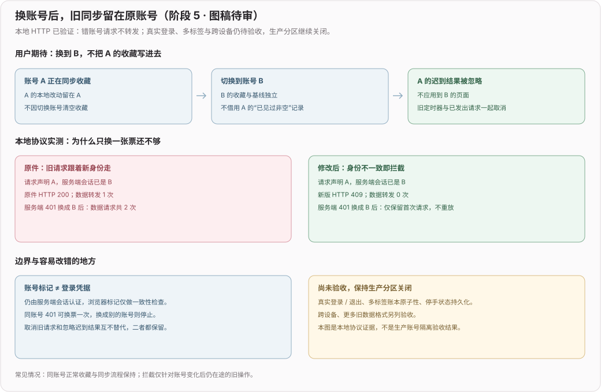

# 访客本地红心歌单入口（待审提案）

## 2026-11-08：持久化停手的存储前置（已实现，仍待审）

发现备份队列将失败转换成成功返回，实际推送继续；Web 普通持久化也会将打开/读取失败当缺失，将写失败吞掉。现在仅对同步基线和滚动备份采用严格失败语义，并让备份调用方收到原操作拒绝。Electron 文件锁等待后复查序号，较新写入已取代本次时不再回写旧值或假报成功。

为什么不在 IndexedDB 故障时改用 localStorage：原基线可能仍在 IndexedDB，另一存储中的空值不代表用户没有历史；此时宁可停止本次同步，保留现状。正常情况下仍读取已有 IndexedDB，确实缺失才按原规则迁移已知旧 localStorage 数据；没有清理真实数据。

本阶段没有新增平台状态或 IPC channel，当前基线的运行时平台实现为 Web / Electron；不据项目规则中移动平台的历史描述虚称 Android/iOS 原生实机通过。现有控制器仍可能按原策略重试本地保存，统一上游停手、明确人工恢复入口、多上下文原子恢复和可见错误状态仍在下一阶段；没有据本次测试解除任何真实上游 hold。

验收为 15 项新增单测 + 150 项已有相关回归；原件同组 37 项 12 失败 / 25 通过，修改后 37 通过。Web事务和Electron IPC均为测试替身；原React页面的保存找回与刷新另有沙箱证据，不当作故障注入界面验收。类型保持206条既有诊断，生产分区不开启。撤回本阶段只还原代码与文档，不删除收藏、基线或备份文件。

## 当前阶段 5：同步捕获账号与会话世代（本地验证，2026-11-06）

本阶段回应维护者评论 6638655494 的 R4-09：换账号时，旧同步操作不应使用新账号凭据，也不应把迟到快照写到新页面。**已落的是共享同步代码和本地协议保护，不是完整生产身份协调；正式 Web 的收藏分区开关仍强制关闭，PR 继续 Draft。**

### 已实现及取舍

- 控制器在整轮同步捕获会话世代与账号，等待 hydration、备份、拉取、推送及记账后复查；失效结果不应用到新账号。登录状态或账号变化时清掉旧防抖、重试定时器、云端版本提示和非空见证。分区模式还必须匹配已启动且未关闭的账号会话，访客会话不满足此条件。
- 客户端换身份实际中止旧 HTTP 请求，并丢弃迟到结果。401 仅允许相同账号重新换票一次；换票后是另一账号，不重放旧操作。取消不是撤回已到达服务端的写入，已按原身份提交的操作仍属于原账号。
- Web 请求增加一致性标记 `X-Biu-Expected-Mid`；BFF 仍用服务端会话认证，标记不是额外权限或身份来源。标记与凭据不符即返回 409，服务端自身 401 换票后也复查原账号。暂保留无标记的旧客户端兼容，不能把这个可选检查当作服务器完整账号隔离认证。
- 同一渲染上下文内，三个同步 store 的基线和滚动副本按队列重读、只更新本账号字段，避免旧全量副本覆盖其他完成项。这不是跨标签事务锁，跨标签/进程原子性另列门槛。
- 同步错误只传播状态、固定消息和过滤后的短业务提示，不把 Axios 的 Cookie/JWT 配置对象交给日志。该处理不等于已经实现限流/5xx 的持久化停手策略。

### 证据分层

| 层级 | 本轮实际结果 | 不据此推断 |
| --- | --- | --- |
| 原件/修改后本地 HTTP | 会话已 B、请求仍 A：200/1 次数据转发 → 409/0 次；BFF 自身 401 换成 B：200/2 次数据请求 → 409/1 次且不重放 | 真实 Cookie 登录/退出已通过 |
| 同一组 51 项契约测试 | 原件 23 失败、28 通过；修改后 51 全过；新增 22 项，另有已有断言随账号标记更新 | 23 个独立产品 bug，或所有平台验收通过 |
| 相关回归 | 17 文件、150 项通过；lint 与格式检查通过 | GitHub CI 或全库类型通过 |
| 类型基线 | 原件/修改后均 206 条相同诊断、退出 2、无新增；中途测试 unknown 收窄错误已修正 | 忽略原始失败记录、称全量类型通过 |
| 原 React 界面 | 通勤角色继续原三曲队列；独立新 A 搜索续集、本地 0→1 保存、离开找回、播放、暂停刷新 00:50 保留 | 沙箱云同步或真实音质通过 |

沙箱仍通过既有边界隔离外部请求，原本不运行生产同步。本轮没有为 UI 验收偷接真实同步服务。协议测试使用 loopback HTTP 和合成身份，和同页面沙箱证据分开。匿名反馈 403 与歌词 503 人工恢复标记保持，未做恢复探测。没有采购或实测单轮费用。

### 发布前仍未完成的门槛

1. **真实身份/UI 协调**：可信 Web 会话刷新、未知身份、退出、同源多标签切换，与分区初始化/写盘顺序的整条原页面路径。R4-01～10 不能仅从本轮协议保护划成完成。
2. **跨标签账本原子性**：同步基线和滚动副本当前只是单上下文串行；需使用平台边界提供的事务、测试两个独立上下文并发，验证失败和升级后的数据关系。
3. **错误停手**：既有传输补试/通知退避还未区分 429、风控及 5xx；需在统一请求边界记录持久化人工恢复状态，阻断控制器、通知与排行的自动入口，刷新后仍保持；离线瞬断与同身份 401 另测。真实上游检查持续暂停，不用生产服务复现该缺口。
4. **跨设备与升级**：隔离账号数据/真实业务链路的双设备验收、更多旧格式和设备级队列/搜索历史隐私规则仍待补。生产分区开关继续关闭；未迁移真实数据，不合并或部署。

本阶段不新增 UI 库或状态库；沿用现有平台边界与状态机。新增账号标记向后兼容、无需服务端数据迁移；维护负担是客户端/BFF 两处一致性检查和契约回归。替代方案“只在页面切换时清 token”挡不住 BFF 内部换票，故不采用。完整持久化停手与多标签事务作为后续同 PR 可审阶段，不用这里的局部通过开启生产。

**回退**：仅撤回本阶段代码提交，保留前四阶段与 master；精确补丁在独立副本反向/正向执行并核对逐文件哈希。回退不清空浏览器数据，不对真实云端做删除或迁移。本图依最新授权先随 Draft PR 审阅，未视为维护者认可。

下面阶段 4/3/2/1 保留历史口径。

## 阶段 4 历史记录：非空目标追加合并（沙箱待审，2026-11-06）

本轮补齐「已有新收藏后再找回旧收藏」：先明确显示“合并旧版收藏 / 合并到当前身份”，不把旧空目标选择静默升级为合并。头像重开会重新检查目标；确认方式发生变化时旧选择失效。原空目标恢复继续保留。

### 已落规则

- 当前歌单和顺序保留；默认红心复用，旧同名默认夹沿既有规则归入红心。其他歌单不按同名覆盖，ID碰撞分配新负数ID，映射随归属和原样副本同事务保存。
- 同一歌单内按稳定资源身份追加去重，当前歌名、收藏时间等元数据优先。旧自建歌单的独有条目、自定义字段及失效处理记录跟随映射保留，包含只有日志而暂时没有歌曲的歌单。
- 完全同名同色标签复用定义；ID碰撞换新ID，旧关联跟随。关联追加去重，不删除当前分类；旧裸rid仅转换到明确的资源身份，避免同数值的视频/音频串绑。同视频不同旧rid也保留当前关联。
- 来源不明的旧音频、无法定位的裸rid标签或标识空间不足不猜测、不半写，保留双方和原件。更多格式与恢复后原件继续变化的增量策略仍未完成。
- 合并结果、原件副本、一次性归属和映射单事务提交；跨账号并发认领、重复提交、旧选择及关闭会话保护不变。

### 实际对照

在同一独立来源先经原界面保存当前Apologize和这个人坏掉了，再写另一份合成旧协议。原31316fa2明确拒绝非空目标；新版明确合并后当前两首仍在，重复Apologize未新增且保留当前歌名/时间，旧自建歌单可找回、播放和刷新。B本地为空，A结果保留；工程页核对原件、归档与目标关系。

试跑另外发现换身份仍停在前身份的私有歌单URL、出现空标题；现在只在身份变化时将该私有路径回主页，公有搜索路径不重置，数据不删除。原有设备级队列和搜索历史仍未隔离，不据此宣称整个浏览器隐私隔离。

### 本轮检查与剩余门槛

新增9项合并、2项明确选择、1项私有路由回归；相关105项通过。9项真实恢复事务检查包含非空ID冲突和旧选择不隐式升级。类型原件/修改后206条相同诊断、退出2，无新增；lint/格式与正式构建另验，不称全量类型或CI通过。临时基线工程文件在最终生产构建前移除，早期带夹具构建仅作为中间记录保留。

规则是待审提案：当前元数据优先、标签追加、同名歌单分开、同色同名标签复用均可在PR中调整。仅已识别旧Web协议的沙箱实现，生产开关继续强制关闭。R4-09真实身份/退出/401/同步控制器世代/跨设备仍未实现；更多格式、访客自建夹入口及完整大规模/实机验收仍待补。原真实用户历史未迁移。

下面阶段3/2/1为历史口径；阶段4范围图仍待审。

## 阶段 3 历史记录：空目标明确恢复（2026-11-05）

本阶段推进 R4-07 的已知旧 Web 协议恢复，不打开生产。先让用户明确选择当前归属，再复制原件；该选择不是原始所有权认证，旧记录没有可信账号来源，相关产品规则仍交维护者审阅。

### 已实现与实际验证

- 启动发现旧记录后展示歌单/歌曲数量及明确目标身份，不自动认领；选择「暂不恢复」不执行恢复，头像菜单仍可再次打开。暂不恢复仅关闭本次，下次启动仍提醒，提醒频率可继续评审。
- 明确恢复时，同一 IndexedDB 事务写入目标快照、一次性归属和原样副本；未分区原件不改写、不删除。当前目标必须没有已保存歌曲、标签或自建歌单；默认空红心允许继续。
- 同一账号重复提交幂等，另一账号不再认领；原件在询问后变化、会话关闭、已发现损坏格式或事务中断均拒绝提交。恢复后旧入口再产生新变化会显式阻断，不静默覆盖；增量合并尚未实现。
- 合成旧样本为 2 歌单/2 首/1 标签，时间固定毫秒，不是真实历史。实际同页面走通暂不恢复→头像重开→恢复到 A→自建歌单与默认红心找回→播放/刷新→B 本地为空→A 重登。旧歌名、自定义歌手、资源身份和标签在原件/归档/目标中按字段核对保留。
- 用相同旧原件回放原件版本 32b6330d，确见「此预览尚未接入旧版收藏恢复，原件已保留」，不是凭源码虚构 before；这是既有预览的能力补齐，不把原保护策略说成生产故障。

| 选择 | 收益 | 取舍 |
| --- | --- | --- |
| 自动给当前账号或访客 | 操作少 | 无可信归属，本阶段不采用 |
| 明确选择且仅恢复到空目标 | 不覆盖现有数据，支持一次归属与原件保留 | 本阶段已实现，策略待审 |
| 非空追加合并与 ID/标签冲突处理 | 覆盖已用新版本后再找回旧数据 | 尚未实现，保留原件并显示具体错误，不伪称支持 |

### 明确未完成

生产真实身份、退出、未知状态/401、同步控制器世代和跨设备仍未接入；生产开关强制关闭。非空目标合并、所有历史格式、恢复后旧入口新增数据的合并策略未完成。当前实际 UI 验收为普通 A 的空目标；访客自建歌单的可见入口不在本阶段，未据此宣称所有角色升级闭环通过。队列和搜索历史仍设备级。

### 复验口径

新增 6 项旧协议/计划回归和 2 项 React 恢复选择回归，相关 93 项通过；8 项真实恢复事务检查含第二次 put 失败回滚首次目标写入，原分区 9 项真实检查也通过。原件/归档/目标的对比是 IndexedDB 记录的 JSON 序列化与字段一致，不是数据库物理文件字节不变。全量类型原件与修改后同为 206 条相同诊断、退出 2，无新增。正式 Web 即使强制设置开关也不含已检查的预览/临时夹具入口，既有演示块仍在。

工程样本与事务检查源码在 `tests/fixtures/web-playlist-legacy-browser.ts`，配套 HTML 同名。它是工程夹具，不是替代产品页；临时复制到 public 的文件在验证后移除，不提交或部署临时入口。范围图更新阶段 3，图稿待审。下面阶段 2/1 为历史口径。

## 阶段 2 历史记录：同页面隔离预览（2026-11-05）

沿 PR #4 继续接入同一套 React 页面、Zustand store 和平台边界，没有另造访客/账号页面。本次开关只在沙箱开发构建中生效，且默认关闭。`BIU_WEB_PLAYLIST_PARTITIONS=true pnpm sandbox` 可开启预览；使用独立全新来源，禁止用清空数据绕过旧数据保护。正式 Web 构建即使设置同名环境变量也固定关闭，不改变生产登录或真实用户存储。

### 已实现并实际走通的预览

- 先等用户持久化与本轮身份刷新，再释放三个个人 store 的读取；全部 hydration 后显式保证默认红心存在，避免初始空读覆盖新建默认夹。
- 账号/访客数据路由到上阶段的事务分区。沙箱可见身份切换先等写盘完成，再关闭旧会话并重载原页面；写盘失败可见且阻断切换。
- 登录账号时显示明确目标的「并入 / 不并入」，两者都等待决定保存。并入后在同账号内应用快照，保留已加载的在线收藏夹，不再次整体 hydrate 掉在线元数据。
- 同一个浏览器、同一来源实际走通：访客保存 Apologize；A 选择不并入，另存梦醒时分；回访访客只见自己的歌；B 明确并入后只有访客歌，A 重登仍只有梦醒时分，且不重复询问。访客再添这个人坏掉了后 A/B 再获询问；A 再次不并入，B 并入只新增 1 首，刷新保留 2 首并能播放，在线默认/音乐/通勤夹仍在。
- 并入失败保留弹窗、支持明确再试、重试后清旧错误，以及未知启动/未完成 hydration 不显示空替身，已补 React DOM 单测；未将这些 mock 失败断言写成真实配额故障验收。
- 已补真实 IndexedDB「写事务已开始后立即关闭会话」检查，修正上一阶段工程页第 6 项覆盖口径，9 项检查仍通过。

### 明确保留的边界

1. 旧未分区记录存在时预览明确阻断并保留原件，不默认分给当前账号或访客；旧归属、认领、升级后可见恢复仍未实现。本轮长期角色仅在普通入口续用，未用预览迁移其历史。
2. 生产身份刷新、未知身份错误处理、真实退出/401、同步控制器世代、按账号推拉和跨设备链路未接入本预览。沙箱原本不跑生产云同步，因此不把本轮当云同步兼容已验收。
3. 播放队列、当前歌曲和搜索历史仍沿用既有设备级持久化；同源换身份仍可见这些状态。这里只验证本地收藏，不宣称整个浏览器会话或全部私人数据按账号隔离。完整隐私规则仍需评审，生产开关继续关闭。
4. 通过的是合成账号/目录/60 秒测试音频，不是真实 B 站 Cookie、真人需求频率、音质或线上验收。

### 本轮验证

新增启动/写盘 7 项、弹窗 8 项、快照应用 1 项，共 16 项新回归；相关测试共 85 项通过。新改代码 lint 零警告；Layout 原件/修改后均 1 条相同既有 context-value 警告，未夹带无关整改。完整类型原件/修改后均 206 条相同诊断、退出 2，无新增；不称全量类型通过。强制设置预览环境变量的正式 Web 构建通过，产物未含所检查的预览/沙箱入口文案，既有离线演示块仍在。

生产账号隔离仍未完成；下方阶段 1 为历史记录，按上方当前范围理解。范围图更新为阶段 2，图稿待审，非维护者已批准。

## 阶段 1 历史记录：存储基础（2026-11-05）

维护者在 PR #4 评论 6638655494 中认可访客找回方向，并明确要求 **Web 按账号实际隔离**。原提案“沿用设备共享数据”的假设已被这一要求取代，不再等待维护者重复选择。

本次已实现并验证的是持久化基础，不是完整隔离功能：账号 A / B / 访客使用独立分区；会话关闭后拒绝迟到结果；显式选择后在单个 IndexedDB 事务中写入红心歌曲与选择。分区模块尚未接入 `platform/web.ts`、登录初始化、并入弹窗及旧数据认领，现有产品界面仍走旧共享存储。**当前 Draft PR 仍不具备合并验收条件。**

### 已落代码与规则

- 收藏夹元数据、歌曲与失效处理记录、标签放在同一账号分区；设置、登录信息、云同步记账和滚动副本不放入该分区。
- 会话捕获不可变的账号目标。调用方结束旧会话后，排队写入及晚到读取显式失败；事务已提交的旧写入仍只在旧分区。后续身份协调必须在切换前关闭旧会话，并禁止未完成读取得到的内容进入新页面。
- 登录时的询问数据由访客红心快照产生，不自动并入。选择并入仅追加目标账号红心，沿用标签使用的资源身份区分视频、分集、音频与本地文件；相同资源保留目标元数据和位置，访客原件及其他歌单/标签不动。
- “不并入”或成功并入均按目标账号 + 访客红心内容版本记下选择；相同内容再次登录不问。访客新增、删除、改名或调整红心内容后版本更新；只改其他歌单不再问。再次手动发起并入入口尚未实现，不写成已有功能。
- 歌曲与决定原子提交。存储失败不记成功，访客原件保留；重复旧弹窗提交不重加歌曲，也不撤销账号后续的删除或“不并入”选择。较旧版本的决定不覆盖新版本。
- 不自动认领未分区老数据；基础模块不会覆盖、删除或改写旧存储键。完整升级规则与可见恢复/认领流程仍待实现，不能把“原件未动”当成“升级后已找回”。

### 未完成的完整用户验收

1. 先停止旧身份同步/未完成应用，解析可信 Web 身份，再加载目标分区，等三个 store hydration 后恢复该账号云同步；处理快速切换、401 与迟到请求。
2. 在原 React 页面接入询问与两个明确选择，显示目标账号；退出只见访客，同账号重登保留历史，A/B 互不混用。
3. 明确未知旧数据、启动时已登录和已退出三类升级归属；保留原件，提供显式认领和失败恢复，不默认分给当前账号或访客。
4. 回测同一浏览器同来源 A/B/访客完整路径、两种弹窗选择、刷新恢复与跨账号同步无误删。真实 Cookie、跨设备及线上/原生设备验收另列。

### 本次证据的口径

18 项新单测、相关回归共 60 项通过；独立工程页在真实浏览器 IndexedDB 上 9 项检查通过（含两个数据库连接并发写与事务中断），不是产品 UI 隔离验收。新契约在模块不存在时是 1 个导入失败套件，不是 18 个既有功能断言失败；产品混用的 before 证据来自上轮实际页面。

新共享基线和修改后全量类型检查均退出 2，规范化依赖相对路径后为相同 206 条诊断，无新增；旧 202 条仅是旧基线的历史结果。两份正式 Web 构建退出 0，未见所检查的沙箱专属标记；基线已有演示数据块仍存在。归档基线构建有缺少 Git 元数据的提示，未做产物字节一致承诺。

分阶段范围图位于 `docs/devlog-assets/本地收藏-Web分区基础.svg`，图稿待审；XML 与普通/宋体预览已核对。下方保留最初导航实现的历史范围和证据，不代表隔离要求已撤销。

## 要完成的用户任务

找到想听的歌，收藏到「我喜欢的音乐」，离开或刷新后再次找到并播放。隔离沙箱中的回访访客与独立新访客都得到「已添加到收藏夹」，但首页和头像菜单没有本地歌单入口。两者是 AI 模拟使用，不是两条真人生产反馈。

## 本阶段的选择

给未登录用户增加同名常驻菜单，打开既有默认本地红心歌单。空歌单也保留入口，避免入口随内容数量变化；已有隐藏菜单偏好优先。沿用同一菜单和页面，不另建访客页面，不增加说明性界面文案。

| 选项 | 收益 | 代价与决定 |
| --- | --- | --- |
| 只补默认红心歌单入口（本提案） | 补齐现有收藏任务的后半程，变化小 | 其他自建本地歌单仍按后续范围评估 |
| 向访客开放整个收藏夹分组 | 可统一管理全部本地歌单 | 容易连带在线创建、排序、同步和账号边界；本阶段不采用 |
| 禁止访客保存或强制先登录 | 规则表面简单 | 收回已有本地收藏能力，与本次实际任务不符；本阶段不采用 |

## 最初导航阶段的假设与账号边界（已由上方隔离要求补充）

- 默认红心歌单已由既有初始化流程创建；本改动只导航，不初始化、迁移、分配或删除数据。
- 访客本地内容继续遵循当前浏览器或设备上的既有规则。登录后的展示仍走原收藏夹分组，不宣称已实现按账号隔离或自动归属。
- 同一设备上的访客数据与登录后账号如何长期归属，仍由维护者审阅决定。本提案不扩大真实账号权限、不改变云同步协议，不把模拟账号隔离当作真实 Cookie 隔离。
- 页面已有的本地管理和播放行为不变；本 PR 不是新建、删除、导入、云同步或共享设备隐私规则的授权。

## 最初导航阶段的验收与回退

- 未登录：展开侧栏、折叠轨和手机抽屉能找到「我喜欢的音乐」；点击打开同一份已保存数据。
- 搜索并保存 → 返回首页 → 从菜单找回 → 播放；刷新后仍能找回。空歌单显示原有空状态。
- 登录用户不重复出现入口；未登录不新增在线收藏夹、云同步、审核或创建能力；隐藏菜单偏好不被覆盖。
- 不改数据格式和存储协议；撤回本 PR 的菜单改动即可恢复旧导航，已收藏数据保留。

当前为可运行实现提案，等待维护者批准、要求修改或否决。审批理由将映射后续回归；提 PR 不等于合并、部署或产品规则已定。
